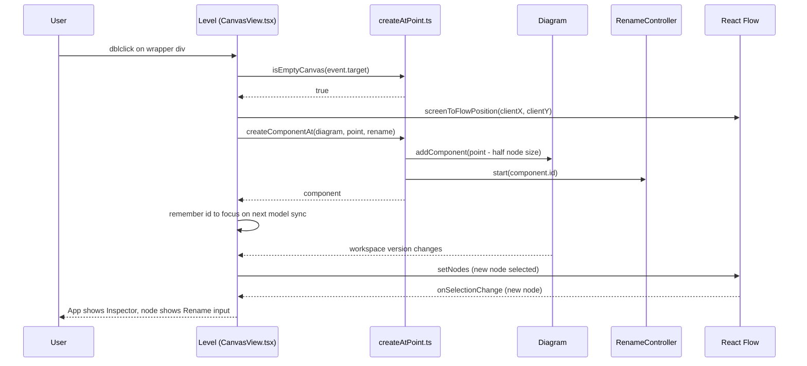

# Design Document

## Overview

Double-clicking the Empty Canvas creates a Component centered on the click and starts Rename on it. The change is view-only: no domain or persistence code changes. It reuses `Diagram.addComponent` (also used by the toolbar), `RenameController`, and the existing selection path (`onSelectionChange` to `App` to `Inspector`).

React Flow 13 has no `onPaneDoubleClick`, so `Level` listens for `dblclick` on a wrapper element and accepts only events whose target is the pane. Nodes, edges, controls and the Rename input are other elements, so they are excluded without extra checks (Requirement 1.2).

## Architecture



## Components and Interfaces

### `createAtPoint.ts` (new, `src/view`)

Responsibility: the React-free part of the interaction, so it is testable without a DOM.

```ts
// Approximate rendered size of a Component with the default name (minWidth 100 + padding + border; one text line).
export const NODE_SIZE = { width: 122, height: 40 }

export function isEmptyCanvas(target: EventTarget | null): boolean
// true only for the React Flow pane element (class `react-flow__pane`).

export function createComponentAt(diagram: Diagram, point: Position, rename: RenameController): Component
// diagram.addComponent({ x: point.x - width / 2, y: point.y - height / 2 }); rename.start(component.id); return component.
```

Collaborators: `Diagram`, `RenameController`. Satisfies 1.1, 1.2, 1.4, 2.2.

React Flow positions a node by its top-left corner, and the node's size is only known after it renders. `NODE_SIZE` is therefore a constant; the default-named Component has a fixed width, so the error is limited to line-height differences.

### `RenameController` (extend)

Add `start(componentId)`: cancels any pending start, sets `editingId`, notifies. The existing timer callback in `schedule` calls `start`, so the "set editing and notify" logic has one home.

`cancel()` is unchanged and only drops a pending start. The selection change caused by creation calls `rename.cancel()` in `Level`, and that call leaves an active Rename alone (Requirement 2.3).

Reused by: Requirements 2.2, 2.3.

### `Level` in `CanvasView.tsx` (extend)

- Wrap `<ReactFlow>` in a `<div>` filling the parent (`width: 100%; height: 100%`) with `onDoubleClick`. The handler returns unless `isEmptyCanvas(e.target)`. Otherwise it converts `clientX/Y` with `useReactFlow().screenToFlowPosition`, calls `createComponentAt`, and stores the new id in state (the lint rule `react-hooks/refs` forbids ref access during render, where the sync runs).
- The existing model-to-React-Flow sync block marks that id as `selected` (replacing the prior selection) and clears it. React Flow then fires `onSelectionChange`, so `App` focuses the new Component and shows the Inspector (Requirement 2.1) with no change to `App`.
- `zoomOnDoubleClick={false}` is already set, and the new code never touches the viewport (Requirement 1.3).

`Toolbar.tsx`, `App.tsx`, `ComponentNode.tsx` and `Navigator.ts` are unchanged. `ComponentNode` already renders `RenameInput` when `editingId` matches, and the input already focuses and selects its text on mount (Requirement 2.2). Commit and cancel keep their current behavior (Requirement 2.4). `Navigator.open` stays tied to `onNodeDoubleClick`, which fires only for nodes, so creation and opening do not collide.

## Data Models

None added. The new Component uses `Diagram.addComponent` defaults, the same call as the toolbar (Requirement 1.4).

## Error Handling

No new failure modes. `createComponentAt` has no domain preconditions. If a double-click lands on a non-pane element, the handler does nothing.

## Correctness Properties

*A property is a characteristic or behavior that should hold true across all valid executions of a system-essentially, a formal statement about what the system should do. Properties serve as the bridge between human-readable specifications and machine-verifiable correctness guarantees.*

### Property 1: Created Component is centered on the point

For any Diagram and any point, `createComponentAt` adds exactly one Component, and that Component's position plus half of `NODE_SIZE` equals the point. The Diagram's viewport is unchanged.

**Validates: Requirements 1.1, 1.3**

### Property 2: Rename starts on the new Component and survives focus changes

For any Diagram and any point, after `createComponentAt` the controller's `editingId` is the returned Component's id, and a following `rename.cancel()` leaves `editingId` unchanged.

**Validates: Requirements 2.2, 2.3**

## Testing Strategy

Property tests (fast-check, at least 100 runs, `src/view/createAtPoint.property.test.ts`), each tagged `Feature: canvas-double-click-create, Property N: ...`:

- Property 1 and Property 2, using the arbitrary workspace builders in `src/domain/testing/workspaceArbitrary.ts` and a fake `Scheduler`.

Example tests:

- `isEmptyCanvas`: true for an element with class `react-flow__pane`; false for node, edge, control and input elements, and for `null` (1.2).
- `createComponentAt` creates a Component with default details (1.4).
- `RenameController.start` drops a pending `schedule` (2.2) and `schedule` still starts Rename after the delay.

Manual UI check (rendering and focus are not property-testable): double-click on the background creates, focuses, shows the Inspector and opens a selected Rename input; Enter commits and Escape cancels; double-click on a node still opens it, and double-click on a Link or the Rename input creates nothing (1.2, 2.1, 2.4).

## Diagram Updates

Update `docs/diagrams/system-architecture.mmd`: add `createAtPoint` to the view layer, with `Level --> createAtPoint`, `createAtPoint --> RenameController` and `createAtPoint -->|addComponent| Diagram`; list `start` among `RenameController` calls.
