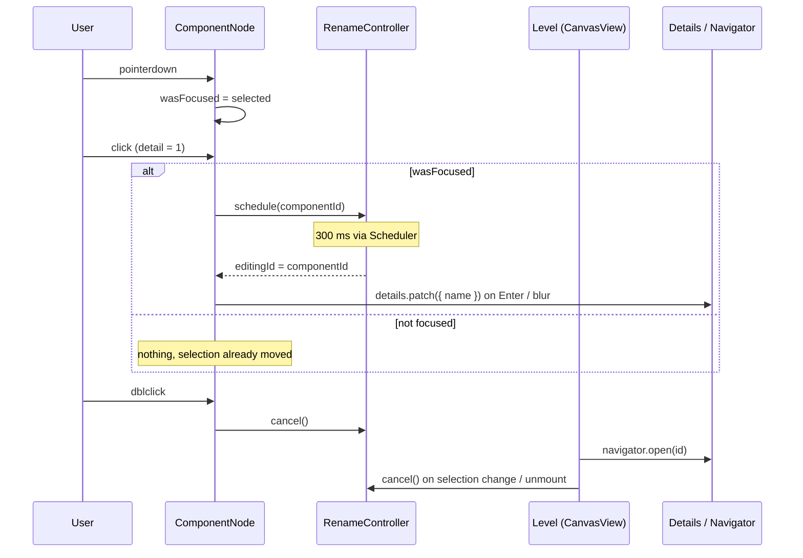

# Design Document

## Overview

Clicking a Component focuses it, clicking the Focused Component renames it in place after a 300 ms Rename Delay, and double-clicking opens it. The change is view-only. No domain class changes: Focus stays React Flow's selection (mirrored by `App`), the name is written with the existing `Details.patch`, and opening uses the existing `Navigator.open`.

Two new pieces:

- `ComponentNode`: a custom React Flow node that renders the name and, during Rename, an input.
- `RenameController`: a small view-layer class that owns the delayed start of Rename and the id of the Component being renamed.

## Architecture

Findings from the existing code that shape the design:

- `CanvasView.Level` already rebuilds nodes from the model on every Workspace version and carries `selected` over. It is keyed by Diagram id, so it unmounts on every Level change.
- `Level` already uses `onNodeDoubleClick` to call `Navigator.open` and sets `zoomOnDoubleClick={false}`.
- `DiagramProjector.toNodes` emits default nodes (`data.label`). They have no `type`, so React Flow renders its default node.
- `Inspector` edits the name via `details.patch({ name })` and re-renders from `useStore(workspace)`. A rename that goes through the same call is therefore reflected there with no extra wiring (Requirement 2.5).
- `Scheduler` (`src/domain/Scheduler.ts`) already abstracts timers so tests can use a fake clock (see `AutoSaver.test.ts`). The Rename Delay reuses it.

React Flow selects a node on pointer down, before `onNodeClick` runs, so a click handler cannot tell whether the node was focused before the click. The node component can: its `selected` prop at pointer-down time still holds the previous value. `ComponentNode` captures that value on `pointerdown` and uses it in its click handler.



### Decisions

| Decision | Rationale |
| --- | --- |
| Custom node type instead of overlay input | The input must sit inside the node, follow drags, and survive the model-driven node rebuild. A node component does this for free. |
| `wasFocused` captured on `pointerdown` in the node | Only point where the pre-click focus is still observable. Avoids a parallel "previously focused" store (the spec forbids new Focus state). |
| `RenameController` as a class using `Scheduler` | Single responsibility, injectable clock, testable without React. Matches `Notifier`/`AutoSaver`. |
| Pending Rename lives in the controller, not in a React ref | Cancellation comes from three places (double-click, selection change, Level unmount). One owner avoids stale closures. |
| Draft text is local to the input; the name is written once on commit | The Inspector shows the saved name during Rename (Requirement 2.5) and Escape needs no rollback. |
| Rename ends before blur handling on Escape | Prevents the blur that follows unmounting the input from committing the discarded text. |

## Components and Interfaces

### RenameController (new, `src/view/RenameController.ts`, no React import)

Responsibility: delay the start of Rename, cancel it, and hold which Component is being renamed.

Implements `ObservableStore` (via `ChangeSignal`) so views subscribe with `useStore`.

```ts
export const RENAME_DELAY_MS = 300

export class RenameController implements ObservableStore {
  constructor(scheduler: Scheduler)
  subscribe; getVersion                  // ObservableStore
  get editingId(): string | undefined    // Component being renamed
  schedule(componentId: string): void    // replaces any pending start; fires start() after RENAME_DELAY_MS
  cancel(): void                         // drops the pending start only
  end(): void                            // clears editingId
}
```

Behavior: `schedule` cancels the previous pending timer first. When the timer fires it sets `editingId` and notifies. `cancel` does not end an active Rename. `end` is idempotent and notifies only when `editingId` was set.

Collaborators: `Scheduler` (injected), `ChangeSignal`.
Used by: `ComponentNode`, `Level`. Satisfies Requirements 2.1, 2.5, 2.6, 3.1.

### ComponentNode (new, `src/view/ComponentNode.tsx`)

Responsibility: render a Component on the canvas and translate pointer events into controller calls.

- Renders the name, a `Handle` of type `target` and one of type `source` (needed for `onConnect`, as the default node provides them), and, while `editingId === id`, an `<input>` with the `nodrag nopan` classes so typing and text selection do not drag or pan.
- `onPointerDown`: records `wasFocused = selected` in a ref.
- `onClick`: if `event.detail === 1` and `wasFocused`, call `controller.schedule(id)`. Clicks with `detail > 1` are ignored (they belong to a double-click).
- `onDoubleClick`: `controller.cancel()`. Opening is left to `Level.onNodeDoubleClick`.
- Input: on mount, focus and select all text (Requirement 2.1). Enter or blur calls `details.patch({ name: draft })` then `controller.end()`. Escape calls `controller.end()` first, then discards the draft. The input's `onDoubleClick` calls `stopPropagation` so React Flow does not fire `onNodeDoubleClick` (Requirement 3.3). An empty draft is saved as is (Requirement 2.4).
- Dragging: `Level.onNodeDragStart` calls `controller.cancel()`, and `ComponentNode` ignores the click that ends a drag (Requirement 1.3). React Flow does not emit `onNodeClick` after a drag, but the node tracks pointer movement of more than a few pixels between `pointerdown` and `click` as a guard. Verify this during implementation.

Reads the Component through `useApp().navigator.current.component(id)` for `details`, subscribed with `useStore(workspace)`. The controller comes from `RenameContext` (below).

Collaborators: `RenameController` (context), `Workspace` and `Navigator` (via `useApp`).
Satisfies Requirements 1.3, 2.1 to 2.5, 3.1, 3.3.

### RenameContext (new, in `ComponentNode.tsx`)

A React context holding the `RenameController`. `nodeTypes` must be a module-level constant for React Flow, so the node cannot receive the controller as a closure. `Level` provides it.

### CanvasView.Level (changed)

- Creates one `RenameController` per Level with `useState(() => new RenameController(scheduler))` and wraps `ReactFlow` in `RenameContext.Provider`.
- Passes `nodeTypes={{ component: ComponentNode }}` (module-level constant).
- In `onSelectionChange`, calls `controller.cancel()` (Requirement 2.6, focus change). An active Rename ends on its own through input blur.
- `useEffect` cleanup calls `controller.cancel()` and `controller.end()` on unmount (Requirement 2.6, Level change). `Level` is keyed by Diagram id, so every Level change unmounts it.
- Adds `onNodeDragStart={() => controller.cancel()}`.
- Keeps `onNodeDoubleClick={(_, node) => navigator.open(node.id)}`. The double-click on an unfocused Component (Requirement 3.2) already selects and then opens.
- Clicking the empty canvas keeps using React Flow's default deselect, which clears Focus (Requirement 1.2). The resulting `onSelectionChange` also cancels any pending Rename.

### DiagramProjector (changed)

`toNodes` adds `type: 'component'`. `data.label` stays for compatibility with existing tests, though `ComponentNode` reads the live name from `Details`. `DiagramProjector.test.ts` is updated for the new field.

### AppServices / main.tsx (changed)

`AppServices` gains `scheduler: Scheduler`. `main.tsx` already builds one `TimerScheduler`; it passes it into `AppProvider`. `Level` reads it with `useApp()`.

### Reuse map

| Component | Requirements |
| --- | --- |
| `RenameController` | 2.1, 2.5, 2.6, 3.1 |
| `ComponentNode` | 1.3, 2.1 to 2.5, 3.1, 3.3 |
| `CanvasView.Level` changes | 1.2, 1.3, 2.6, 3.2 |
| Existing `Details.patch`, `Navigator.open`, selection mirror in `App` | 1.1, 2.2, 2.4, 2.5, 3.1, 3.2 |

Requirement 1.1 needs no new code: clicking an unfocused node already selects it and `App` shows it in the Inspector. A test locks it in.

## Data Models

No domain or persisted data changes. View-only state:

- `RenameController.editingId: string | undefined`, plus a private pending timer handle.
- `ComponentNode`: `wasFocused` ref and the input draft string.

## Error Handling

- `details.patch` cannot fail. If the Component is deleted while its input is open (for example by a cascade), `Level` rebuilds nodes without it, `ComponentNode` unmounts, and the input disappears without committing. The controller's `editingId` is stale, so `ComponentNode` for another id is never affected. `Level` cleanup and the next `end()` clear it.
- If the pending timer fires for a Component no longer on the Level, `ComponentNode` for that id does not exist, so nothing renders. The Level change case is covered by cleanup cancelling the timer.
- Unexpected exceptions are not caught, consistent with the rest of the view layer.

## Testing Strategy

Property-based testing does not apply. The new logic is UI event handling and a timer state machine with a handful of discrete states, so the input space gives no edge cases that a few examples miss. Correctness Properties are omitted.

Example-based unit tests (Vitest, `src/view/*.test.ts`, fake `Scheduler` as in `AutoSaver.test.ts`):

- `RenameController`
  - `schedule` does not start Rename before 300 ms and starts it at 300 ms (2.1).
  - A second `schedule` replaces the first; only one start occurs.
  - `cancel` before the delay prevents the start (2.6, 3.1); `cancel` after start leaves `editingId` set.
  - `end` clears `editingId` and notifies once; a second `end` does not notify.
  - Subscribers are notified on start and end.
- `DiagramProjector`: nodes have `type: 'component'`.

Component tests only where the logic is not trivial, using a DOM test environment if one is already configured. If none exists, these behaviors are checked manually instead of adding a test dependency:

- Click unfocused: no input appears (1.1). Click focused, wait 300 ms: input appears with text selected (2.1).
- Enter and blur save; Escape keeps the old name; empty name saves (2.2 to 2.4). Inspector shows the saved name during Rename (2.5).
- Double-click on a focused Component opens it with no input shown (3.1). Double-click inside the input selects text and does not open (3.3).
- Selecting another element or navigating during the delay cancels Rename (2.6). Dragging does not start Rename (1.3).

Run `npm run build`, `npm test`, and `npm run lint` before completion.

## Documentation

Update `docs/diagrams/system-architecture.mmd`: add `ComponentNode` and `RenameController` to the view layer, with `CanvasView` owning the controller and `ComponentNode` using it, and `Scheduler` injected into it.

## Open Questions

- Whether this project's Vitest setup has a DOM environment (jsdom). If not, the component-level checks above stay manual.
