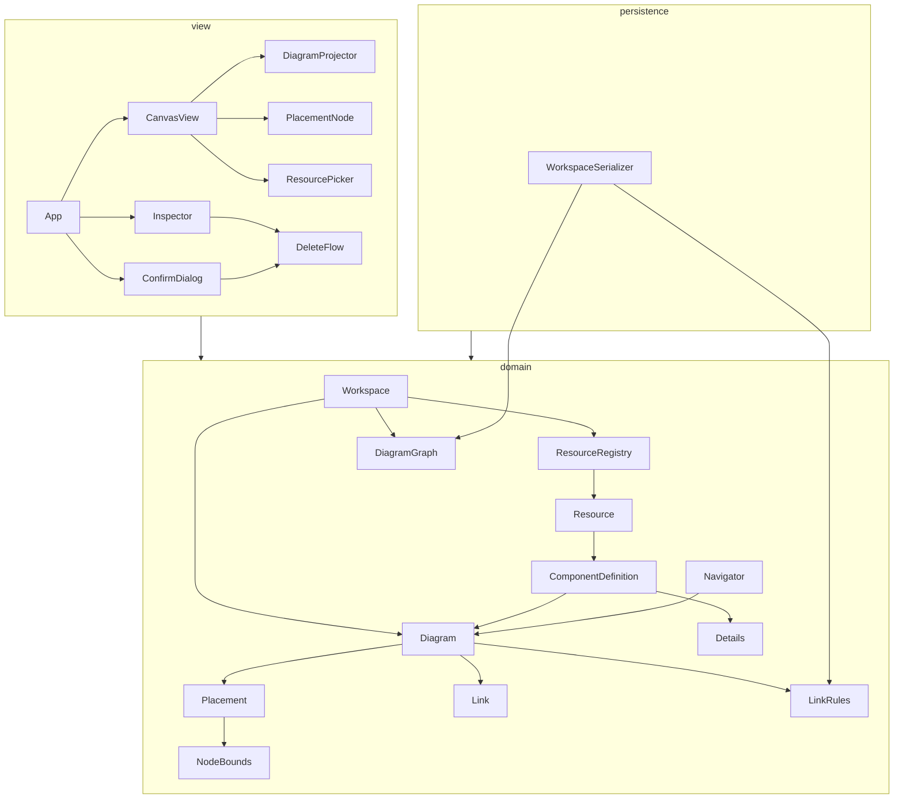

# Design Document

## Overview

A Component becomes a fourth Resource kind. The `Component` class disappears. A Diagram holds only Placements and Links, and a Placement is a bounded reference to a Resource. A component Resource owns the old Component state (Details, exception ids, environment variable ids) and one child Diagram, so one definition can be placed in many Diagrams.

Decisions:

1. **One node type.** Every node in a Diagram is a Placement. Behaviour that used to branch on "Component or Placement" now branches on `resource.kind === 'component'`, or not at all.
2. **Ports belong to the Resource, Links to the Diagram.** A Link stores Placement ids and the Resource's port ids, and lives in the Diagram holding both Placements. The registry stores no Links (Requirement 1.6). The child Diagram is shared, so its Links are shared.
3. **Diagrams are found through the registry, not by walking a tree.** The Diagram set is the root plus the child Diagram of every component Resource, placed or not. The nested tree no longer exists; the structure is a directed graph of Diagrams.
4. **Cycles are prevented at the three entry points** (addPlacement, paste, load) by one pure graph function.
5. **Deleting a Resource never cascades to other Resources.** It removes the Resource, its Placements, their Links, and a component's own child Diagram. Resources placed inside that Diagram stay in the registry, possibly unplaced, exactly as removing a Placement keeps its Resource.

`src/domain` and `src/persistence` stay free of `react` and `@xyflow/react`.

## Architecture



## Components and Interfaces

### Domain

#### NodeBounds and Placement (changed)

Responsibility: a node's own geometry and its Resource id, nothing else (Requirement 1.3, 2).

`Position` and `Size` move from `Component.ts` into `NodeBounds.ts`. The `Positioned` interface is deleted: `Placement` is its only implementer, so `Diagram.placement(id)` replaces `Diagram.positioned(id)`. `Placement` itself is unchanged.

Collaborators: Diagram, Workspace.

#### ComponentDefinition (new, replaces `Component.ts`)

Responsibility: the state only a component Resource has. It is `Component` minus id and bounds (Requirements 1.2, 1.4).

```ts
export class ComponentDefinition {
  readonly details: Details
  readonly diagram: Diagram          // the one child Diagram, shared by every Placement
  get exceptionIds(): readonly string[]
  get environmentVariableIds(): readonly string[]
  setExceptions(ids: readonly string[]): void           // notifies
  setEnvironmentVariables(ids: readonly string[]): void // notifies
  dropException(id: string): void                       // silent, Workspace notifies once
  dropEnvironmentVariable(id: string): void             // silent
}
```

The exception and variable methods are moved from `Component` unchanged. Collaborators: Resource, Details, Diagram (type import only).

#### Resource (changed)

Responsibility: a shared definition. Gains `definition: ComponentDefinition | null`, non-null exactly when `kind === 'component'`. The constructor rejects a mismatch with `INVALID_RESOURCE`, the same way it already guards `typeId`.

For a component, `name` reads `definition.details.name` and `setName` calls `details.patch({ name })`. Details stays the single owner of the name, so the inline rename input and the Inspector edit the same field, and each edit is one notification.

```ts
constructor(id, kind, name, typeId, definition: ComponentDefinition | null, onChange)
get name(): string          // definition ? definition.details.name : stored name
readonly definition: ComponentDefinition | null
```

Requirements: 1.1, 1.2, 1.4.

#### ResourceKinds (changed)

Add `component: { typed: false, sourceIds: [], targetIds: [] }` and `'component'` to `ResourceKind`. The empty id lists are never read: a component's handles are its Details ports, resolved in `Diagram.endShape` (below). The ResourcePicker menu iterates `RESOURCE_KINDS`, so Component appears there with no further change (Requirement 7.1).

#### LinkRules (unchanged)

`EndShape` already has a `component` variant carrying port ids. `Diagram.endShape` and the serializer now return it for a Placement of a component Resource and the `placement` variant for any other kind. `LinkRules.ts` itself needs no edit.

#### DiagramGraph (new, `DiagramGraph.ts`)

Responsibility: cycle detection over plain data, so the domain and the serializer share one implementation (Requirements 3.4, 4.1, 8.5).

```ts
// Diagram id -> ids of the child Diagrams of component Resources placed in it.
export type DiagramGraph = ReadonlyMap<string, readonly string[]>
export function reaches(graph: DiagramGraph, from: string, to: string): boolean // reflexive
export function findCycle(graph: DiagramGraph): string | undefined              // a Diagram id on a cycle
```

Adding a Placement of component Resource R to Diagram D adds the edge D → R.diagram. It creates a cycle exactly when `reaches(graph, R.diagram.id, D.id)`. Because `reaches` is reflexive, placing R inside its own child Diagram is covered.

#### Diagram (changed)

Responsibility: Placements, Links and viewport of one Level. It no longer owns child Diagrams.

```ts
export type DiagramContext = {
  ids: IdGenerator
  onChange: () => void
  resources: ResourceLookup
  wouldCreateCycle: (target: Diagram, resourceId: string) => boolean // supplied by Workspace
}
class Diagram {
  get placements(): readonly Placement[]
  get links(): readonly Link[]
  placement(id: string): Placement | undefined
  resourceOf(placementId: string): Resource | undefined   // how a Diagram resolves a Placement
  addPlacement(resourceId, position): Placement           // MISSING_RESOURCE, REFERENCE_CYCLE
  removePlacement(id): void                               // keeps the Resource
  addLink / removeLink                                    // unchanged signatures
  addAll(placements, links): void                         // one notification, for paste
  dropPlacementsOf(resourceId): void                      // silent
  dropLinksOnPorts(resourceId, field, keptIds: ReadonlySet<string>): void // silent
  countPlacementsOf(resourceId): { placements: number; links: number }
}
```

Resolution: a Placement stores only `resourceId`; `resourceOf` looks it up in `ctx.resources`. `endShape(id)` calls `resourceOf` and returns `{ kind: 'component', inputIds, outputIds }` from `definition.details` for a component, else `{ kind: 'placement', resource: kind }`. The Link check and the view therefore read live ports, so a port edit is visible everywhere with no copying.

Removed: `components`, `component(id)`, `positioned(id)`, `addComponent`, `removeComponent`, `deletionImpact`, `setPorts`, `countDescendants`. Port editing moves to Workspace, because it touches several Diagrams.

`dropLinksOnPorts` removes a Link when its source end is a Placement of the Resource and `field === 'outputs'` and `sourcePortId` is not kept, or its target end is a Placement of the Resource and `field === 'inputs'` and `targetPortId` is not kept.

#### Workspace (changed)

Responsibility: registry, catalogs, and every operation that crosses Diagrams. Each operation below ends in exactly one `signal.notify()` (or one `onChange` through a single mutator), so History records one undo step.

```ts
allDiagrams(): Diagram[]   // public: [root, ...component Resources' definition.diagram]
wouldCreateCycle(target: Diagram, resourceId: string): boolean
createPlacedResource(diagram, spec: { kind; name; typeId? }, position): Placement
setPorts(resourceId: string, field: 'inputs' | 'outputs', ports: readonly NewPort[]): void
resourceImpact(id: string): ResourceImpact
removeResource(id: string): void
copy(diagram, nodeIds): Fragment
paste(diagram, fragment, offset): { placements: Placement[]; links: Link[] }
```

**Diagram set.** `allDiagrams()` replaces the recursive walk. It includes the child Diagram of an unplaced component Resource, so catalog operations still reach it. `allComponents()` becomes `componentResources()` = `registry.byKind('component')`; `exceptionUsage` and `environmentVariableUsage` count component Resources, and `removeException` and `removeEnvironmentVariable` drop the id from each `definition`, then notify once. `isTypeInUse` checks Resource `typeId`, the ports of each `definition.details`, and the Link `details` of every Diagram in `allDiagrams()`.

**createPlacedResource.** For `kind: 'component'` it builds `new ComponentDefinition(new Details(onChange, { name }), new Diagram(ids.next(), ctx), …)` and a Resource around it, adds the Resource, then calls `diagram.addPlacement`. The `addPlacement` notification covers both, so creation is one step (Requirement 7.2, 7.4). A new Resource's Diagram is unreachable from anywhere, so the cycle check cannot fail.

**setPorts (Requirement 5).** Validates that the Resource is a component, assigns ids to new ports (`p.id ?? ids.next()`), calls `dropLinksOnPorts` on every Diagram in `allDiagrams()` without notifying, then `definition.details.patch({ [field]: next })`, which notifies once. Port removal and Link removals are one step.

**Cycle detection (Requirements 3.4, 4.1).**

```ts
private diagramGraph(): DiagramGraph  // for each Diagram: ids of child Diagrams of component Resources it places
wouldCreateCycle(target, resourceId) {
  const child = this._resources.get(resourceId)?.definition?.diagram
  return !!child && reaches(this.diagramGraph(), child.id, target.id)
}
```

The same method is passed in `DiagramContext`, so `addPlacement`, `paste` and the Picker filter use one rule. `Diagram.addPlacement` and `Workspace.paste` throw `DomainError('REFERENCE_CYCLE', …)`. `paste` checks every distinct `resourceId` in the fragment before changing anything. One check per Resource is enough: any new cycle passes through the target Diagram once, so it uses one new edge.

**copy / paste (placements only).** `Fragment` is `{ placements: PlacementDto[]; links: LinkDto[] }`. `copy` filters `diagramToDto(diagram)` to the selected Placements and the Links with both ends selected. `paste` validates, in order and before mutating: every `resourceId` exists (`MISSING_RESOURCE`), then no cycle (`REFERENCE_CYCLE`). It gives each Placement and Link a fresh id, shifts positions, and calls `diagram.addAll`. Port ids are kept: they belong to the Resource and are valid in any Diagram holding a Placement of it. `withFreshIds` shrinks to a Placement id map and a Link id regeneration; the nested-Diagram recursion is deleted. No Resource or child Diagram is ever copied (Requirement 3.3).

**resourceImpact and removeResource (Requirement 6).**

```ts
type ResourceImpact = {
  placements: number                          // Placements of the Resource, all Diagrams
  links: number                               // Links touching those Placements
  contents?: { nodes: number; links: number } // component only: its child Diagram's Placements and Links
}
```

`contents` counts the child Diagram directly (`placements.length`, `links.length`), not recursively: nested component Resources stay in the registry and are not removed. `removeResource` calls `dropPlacementsOf(id)` on every Diagram in `allDiagrams()` (computed before removal, so a component's own Diagram is included but irrelevant), then `registry.remove(id)`, then notifies once. Nothing else leaves the registry. The component's child Diagram becomes unreachable with the Resource and disappears from `allDiagrams()`.

**replaceContent (viewport preservation).** Before reloading, collect `Map<diagramId, Viewport>` from `allDiagrams()`. `loadResources(dtos, viewports)` rebuilds each Resource, and for a component builds `definition.diagram` with `buildDiagram(dto, ctx, viewports)`. Then `_root = buildDiagram(parsed.root, ctx, viewports)`. A Diagram whose id has no entry (created after the snapshot was undone) uses the snapshot viewport, as today.

**Snapshot.** `toSnapshot` writes `schemaVersion: 9`, and per Resource `{ id, kind, name, typeId, component: ComponentDto | null }`. `capture()` and `toSnapshot(false)` keep the viewport-free form.

#### Navigator (changed)

The path is a list of Placement ids. Each step is resolved in the previous Diagram: `diagram.placement(id)`, then `diagram.resourceOf(id)?.definition?.diagram`.

```ts
trail(): readonly Resource[]   // component Resources along the path, for the Breadcrumb
open(placementId: string): void // NOT_IN_DIAGRAM if absent, NOT_A_COMPONENT if not a component
get current(): Diagram          // last definition.diagram, or root
```

`reconcile()` and `navigateTo()` are unchanged. The constructor still takes `{ root: Diagram }`, since `Diagram.resourceOf` carries the registry. Opening a Placement opens the Resource's shared Diagram, so two Placements of one Resource open the same Level and the same viewport.

#### DomainError (changed)

Add codes `REFERENCE_CYCLE` and `NOT_A_COMPONENT`.

#### WorkspaceSnapshot (changed)

```ts
export type ComponentDto = {
  details: DetailsDto
  exceptionIds: string[]
  environmentVariableIds: string[]
  diagram: DiagramDto
}
export type ResourceDto = { id; kind; name; typeId: string | null; component: ComponentDto | null }
export type DiagramDto = { id; viewport; placements: PlacementDto[]; links: LinkDto[] }
export type Fragment = { placements: PlacementDto[]; links: LinkDto[] }
schemaVersion: 9
```

`ComponentDto` no longer has `id`, `position` or `size`; those belong to the Placement. For a component, `name` is written from `details.name` and the serializer reads `name` back from `details.name`, so there is one source.

### Persistence

#### WorkspaceSerializer (changed)

`deserialize` requires `schemaVersion === 9` (Requirement 8.1, 8.2). Validation order:

1. Parse catalogs. Parse each Resource's header (id, kind, `typeId`, and for a component its `details`) into `shapes: Map<resourceId, EndShape>`: `component` with port ids, else `placement` with the kind. This is the first pass, needed because Diagrams refer to Resources defined anywhere in the list.
2. Parse the root Diagram and each component's child Diagram with `parseDiagram(v, path, shapes)`. A Placement whose `resourceId` is not in `shapes` fails naming the Placement id (8.3). Each Link is checked with `checkLink` against the shapes of its two Placements and fails naming the Link id (8.4).
3. Build the `DiagramGraph` from the DTOs (root, plus each component's Diagram; an edge per Placement of a component Resource). `findCycle` returning a Diagram id fails with `PersistenceError` naming the component Resource that owns that Diagram (8.5).
4. `assertTypesExist`, `assertExceptionsExist`, `assertEnvironmentVariablesExist` iterate the Resources' definitions and every Diagram's Links instead of recursing through `components`.

### View

#### PlacementNode (merged with ComponentNode)

`ComponentNode.tsx` is deleted. `PlacementNode.tsx` becomes the only registered node type (`nodeTypes = { placement: PlacementNode }`) and the single place for the resizer, the stored-size floor, and `onResizeEnd` (`navigator.current.placement(id)?.setBounds(…)`). It reads `const resource = diagram.resourceOf(id)` and branches once:

- `resource.kind === 'component'`: the content moved from ComponentNode: two `PortList`s (inputs, outputs), the name body, the open button, inline rename, and `measureMinSize`. `PortList.onChange` calls `workspace.setPorts(resource.id, field, next)`. The open button calls `navigator.open(id)`. The minimum size is `NODE_SIZE` or the measured content.
- otherwise: the existing icon, name, type, and side or database Handles, with minimum size `MIN_SIZE`.

`RenameContext`, `useRenameController` and `RenameInput` move to `PlacementNode.tsx`; `LinkEdge` changes its import. `RenameInput` still takes a `Details`, so a component passes `resource.definition.details` and a Link passes its own. Both branches keep their current CSS class names (`component-node`, `placement-node`), so `index.css` is unchanged. Hooks stay unconditional by splitting the two branches into two small inner components rendered by `PlacementNode`.

#### Inspector (merged with ResourceInspector)

`ResourceInspector.tsx` is deleted. `Inspector.tsx` takes `item: Placement` and renders, from `resource = workspace.resources.get(item.resourceId)`:

- Name for every kind through `resource.setName`.
- Data Type select when `RESOURCE_KINDS[kind].typed` (moved from ResourceInspector).
- When `resource.definition` is set: inputs, outputs, exceptions, environment variables and notes, with their current markup. Port edits call `workspace.setPorts(resource.id, …)`; exception and variable edits call `definition.setExceptions` and `definition.setEnvironmentVariables`.
- Two buttons: "Delete" (`placement`) and "Delete resource" (`resource`).

`App.tsx` renders one Inspector for the selected Placement and drops the `component`/`placement` selection split. The aria-label becomes "Details".

#### DeleteFlow and ConfirmDialog (changed)

`DeleteTarget.kind` is `'link' | 'placement' | 'resource'`. `PendingDelete` is `{ counts: ResourceImpact; run(): void }`. `request` for `resource` stores `workspace.resourceImpact(id)`. The `component` case and `deletionImpact` use are deleted. `ConfirmDialog` states the Placements and Links removed, and when `counts.contents` is set, the nodes and Links inside the Resource's Diagram and that Resources placed there stay in the registry (Requirement 6.2). Cancel and the single undo step are unchanged (6.4, 6.5).

#### ResourcePicker, resourceIcons (changed)

`KIND_LABELS` and `ICONS` gain a `component` entry (both are `Record<ResourceKind, …>`, so the compiler flags a missing one). The existing-Resource list is filtered with `!workspace.wouldCreateCycle(diagram, resource.id)` (Requirement 4.2). Create works unchanged: component is untyped, so it takes a name only.

#### createAtPoint and CanvasView (changed)

`createComponentAt(workspace, diagram, point, rename): Placement` calls `workspace.createPlacedResource(diagram, { kind: 'component', name: '' }, centred)` and `rename.start(placement.id)` (Requirement 7.2, 7.3). In `CanvasView`: `onBeforeDelete` requests `placement` for every node; `onSelectionChange` reports `placement` or `link`; `onNodeDragStop` and `onSelectionDragStop` use `diagram.placement(id)?.setPosition`; the paste handler catches `DomainError` (now also `REFERENCE_CYCLE`) as it does for `MISSING_RESOURCE`; `Copied` and `pasteOffset` use `fragment.placements` only.

#### DiagramProjector (changed)

`toNodes` maps `diagram.placements` to `{ id, type: 'placement', position, data: {} }`. The `data.resourceId` copy is dropped because `PlacementNode` resolves the Resource itself. `toEdges` is unchanged.

#### Breadcrumb (changed)

Labels come from `navigator.trail()` Resources: `r.name || 'Untitled'`.

### Test support

- `workspaceArbitrary.ts`:
  - `allDiagrams(workspace)` is deleted in favour of `workspace.allDiagrams()`; `allComponents` becomes `componentResources(workspace)` = `workspace.resources.byKind('component')`.
  - `Command` drops `removeComponent`, `addLink` (component to component), `addResourceLink`, `addPlacementLink`. It keeps `addComponent`, now `createPlacedResource` with `kind: 'component'`, and adds one `addLink` that picks two Placements in the Diagram and a port id from a test-only `handleIds(workspace, placement, role)`: Details ports for a component, `RESOURCE_KINDS[kind].sourceIds/targetIds` otherwise.
  - `patchComponent`, `toggleException`, `toggleEnvironmentVariable` pick a component Resource; port patches call `workspace.setPorts`.
  - `addPlacement` is skipped when `workspace.wouldCreateCycle(d, r.id)`, so generated workspaces are acyclic and every command remains valid for any shape.
  - `resourceKindArb` already derives from `RESOURCE_KINDS`, so `addResource` generates components with no edit; `removeResource` already exists.
  - Every command stays one notification, which the History properties rely on.
- `connect.ts` becomes `connect(workspace, diagram, source: Placement, target: Placement): Link`, adding a fresh output and input with `workspace.setPorts`.
- Shared-resource cases come from generated `addPlacement` commands; no extra helper.

## Data Models

```ts
Resource      { id, kind, name, typeId|null, definition: ComponentDefinition|null }
ComponentDefinition { details: Details, exceptionIds, environmentVariableIds, diagram: Diagram }
Placement     { id, resourceId, bounds }
Diagram       { id, viewport, placements[], links[] }
Link          { id, details, sourceId, targetId, sourcePortId, targetPortId }   // ends are Placement ids
```

## Error Handling

| Condition | Where | Result |
| --- | --- | --- |
| Placement of a missing Resource (add, paste) | Diagram, Workspace.paste | `DomainError MISSING_RESOURCE`, no change |
| Placement or paste would create a cycle | Diagram.addPlacement, Workspace.paste | `DomainError REFERENCE_CYCLE`, no change (paste checks before mutating) |
| Open a non-component Placement | Navigator.open | `DomainError NOT_A_COMPONENT` |
| `setPorts` on a non-component or unknown id | Workspace | `DomainError INVALID_RESOURCE` / `MISSING_RESOURCE` |
| Bad schemaVersion, unknown Resource, bad Link port, cycle | WorkspaceSerializer | `PersistenceError` naming the Placement, Link or Resource id; the Loader starts empty with saving disabled, as today |

View code posts `DomainError` messages through the Notifier (Picker, paste, connect), as it does now.

## Existing tests that must change

| File | Change |
| --- | --- |
| `Diagram.test`, `Workspace.test`, `Navigator.test`, `copyPaste.test`, `LinkRules.test` | Replace `addComponent`/`component()` with `createPlacedResource` and `placement()`; Navigator opens Placement ids; copyPaste uses placement-only Fragments and adds a cycle-rejected paste case. LinkRules needs no edit unless it imports `Component`. |
| `createdComponents.property` | Rewrite: a new component Resource has empty ports and an empty child Diagram, and creation adds one Resource and one Placement. |
| `deletionCascade.property`, `deletionImpact.property` | Rewrite for `removeResource`/`resourceImpact` with the new scope: other Resources survive, Links stay valid, counts match what is removed. |
| `edits.property`, `viewports.property`, `navigation.property` | Target component Resources and Placement ids; navigation follows Placement ids into shared Diagrams. |
| `validLinks.property`, `invalidLinks.property`, `resourceLinks.property` | Merge onto the single Placement-to-Placement `addLink` command; keep the self-link, foreign-end and wrong-role cases. |
| `resources.property` | Add component to kind generation; edit propagation covers `definition`. |
| `history.property` | Command set changes; one-step-per-command must still hold, including `setPorts` and `createPlacedResource`. |
| `WorkspaceSerializer.test`, `WorkspaceLoader.test`, `LocalStorageRepository.test`, `AutoSaver.test`, `roundTrip.property` | `schemaVersion` 9 and the new snapshot shape; new rejection cases (unknown Resource, bad port, cycle). |
| `DeleteFlow.test`, `DiagramProjector.test`, `createAtPoint.test`, `createAtPoint.property`, `pasteOffset.test` | No `component` delete kind, single node type, `createComponentAt(workspace, …)`, Fragment without components. |

## Correctness Properties

*A property is a characteristic or behavior that should hold true across all valid executions of a system-essentially, a formal statement about what the system should do. Properties serve as the bridge between human-readable specifications and machine-verifiable correctness guarantees.*

### Property 1: Resource edits are visible through every Placement

For any workspace and any component Resource with any number of Placements, a change to its name, ports, notes, exceptions or environment variables changes only that Resource's entry in the snapshot, and every Placement of it still resolves to that Resource.

**Validates: Requirements 1.4**

### Property 2: Placement bounds are private

For any workspace and any Placement, `setPosition` or `setBounds` changes only that Placement in the snapshot, and any newly created Placement has a fresh id and the given position.

**Validates: Requirements 2.1, 2.2**

### Property 3: Links are valid and live in their Diagram

For any workspace built from any command sequence, every Link in every Diagram has both ends as Placements in that same Diagram, and each end's port id is a port of the Placement's Resource, and the registry holds no Links.

**Validates: Requirements 1.6, 5.1**

### Property 4: Paste references the same Resources

For any Diagram, any selection of Placements and any target Diagram where no cycle results, pasting adds one Placement per copied Placement with the same `resourceId` and a fresh id, keeps the Links between copied Placements, and leaves the registry unchanged.

**Validates: Requirements 3.1, 3.2**

### Property 5: Cycles are rejected without change

For any workspace, any Diagram D and any component Resource R, `addPlacement` and `paste` throw `REFERENCE_CYCLE` and leave `capture()` unchanged exactly when D is R's child Diagram or is reachable from it, and otherwise succeed.

**Validates: Requirements 3.4, 4.1, 4.2**

### Property 6: Port removal is one undo step and prunes every Diagram

For any workspace, any component Resource and any new port list, `setPorts` records exactly one History step, and afterwards no Link in any Diagram references a removed port of that Resource.

**Validates: Requirements 5.1, 5.2**

### Property 7: Removing a Placement keeps its Resource

For any workspace and any Placement, `removePlacement` removes that Placement and the Links attached to it, and leaves the registry and every other Diagram unchanged.

**Validates: Requirements 6.1**

### Property 8: Impact matches deletion

For any workspace and any Resource, `resourceImpact` reports the Placements and Links, and for a component the nodes and Links of its child Diagram, that `removeResource` then removes.

**Validates: Requirements 6.2**

### Property 9: Resource deletion removes only its own scope

For any workspace and any Resource, `removeResource` removes only that Resource, every Placement of it, the Links attached to those Placements and, for a component, its child Diagram; every other Resource stays in the registry, and the removal is one History step.

**Validates: Requirements 6.3, 6.5**

### Property 10: Double-click creation is one step

For any workspace, Diagram and point, `createComponentAt` adds exactly one component Resource and one Placement in one History step, and undo removes both.

**Validates: Requirements 7.2, 7.4**

### Property 11: Corrupt snapshots are rejected

For any valid snapshot and any single corruption (wrong `schemaVersion`, unknown `resourceId`, Link port not on the Resource, or a Placement that closes a Diagram cycle), `deserialize` throws `PersistenceError`.

**Validates: Requirements 8.2, 8.3, 8.4, 8.5**

### Property 12: Snapshots round trip

For any generated workspace, including shared and unplaced Resources, `serialize(restore(deserialize(JSON round trip(serialize(w)))))` equals `serialize(w)` at `schemaVersion` 9.

**Validates: Requirements 8.1, 8.6**

## Testing Strategy

- Property tests use fast-check with at least 100 runs, in `src/**/*.property.test.ts`, tagged `Feature: components-as-resources, Property N: …`. Domain and persistence properties use `workspaceArb` and its commands.
- Example tests cover: the `schemaVersion` 9 check, a Picker that omits cyclic components (4.2), cancel leaving the Workspace unchanged (6.4), the Picker listing Component (7.1), and inline rename starting on the new Placement (7.3).
- UI rendering (PlacementNode, Inspector layout) is not property-tested.
- Run `npm run build`, `npm test` and `npm run lint` before calling the work done.

## Documentation

Requirement 9: update `docs/diagrams/domain-model.mmd` (Placement replaces Component; Resource, ComponentDefinition, DiagramGraph, Diagram graph), `system-architecture.mmd` (ComponentNode and ResourceInspector removed, merged into PlacementNode and Inspector), and `docs/clear-saved-data.md` (`schemaVersion` 9), with the README index updated if a diagram is added.

## Requirement Coverage

| Requirement | Design component |
| --- | --- |
| 1 | Resource, ComponentDefinition, Placement, Diagram, ResourceKinds |
| 2 | NodeBounds, Placement, Workspace.createPlacedResource |
| 3 | Workspace.copy / paste, DiagramGraph |
| 4 | DiagramGraph, Workspace.wouldCreateCycle, Diagram.addPlacement, ResourcePicker |
| 5 | Workspace.setPorts, Diagram.dropLinksOnPorts |
| 6 | DeleteFlow, ConfirmDialog, Workspace.resourceImpact / removeResource, Diagram.dropPlacementsOf |
| 7 | ResourcePicker, createAtPoint, Workspace.createPlacedResource |
| 8 | WorkspaceSerializer, DiagramGraph, WorkspaceSnapshot |
| 9 | Documentation |
