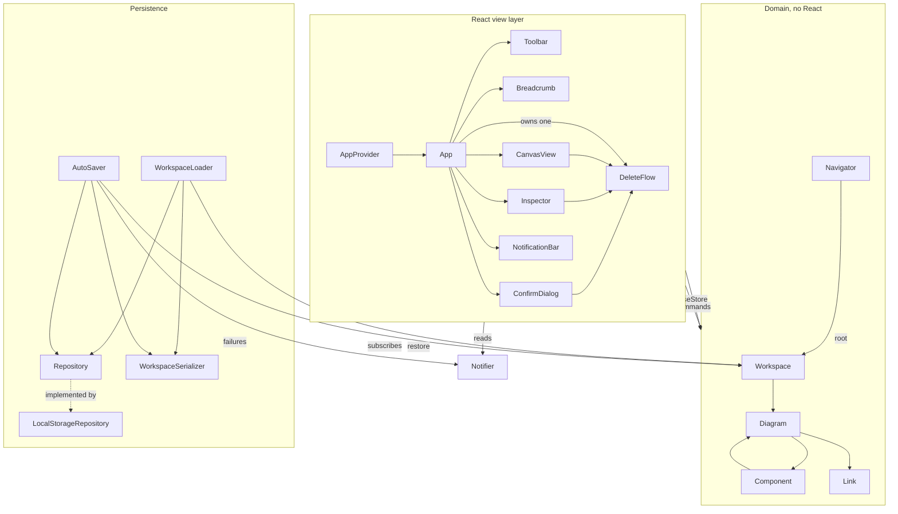
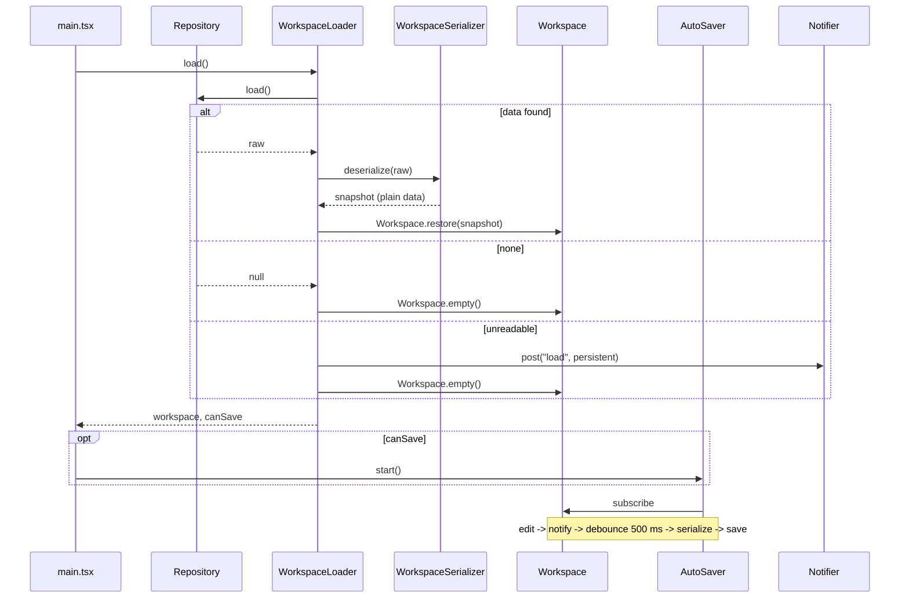
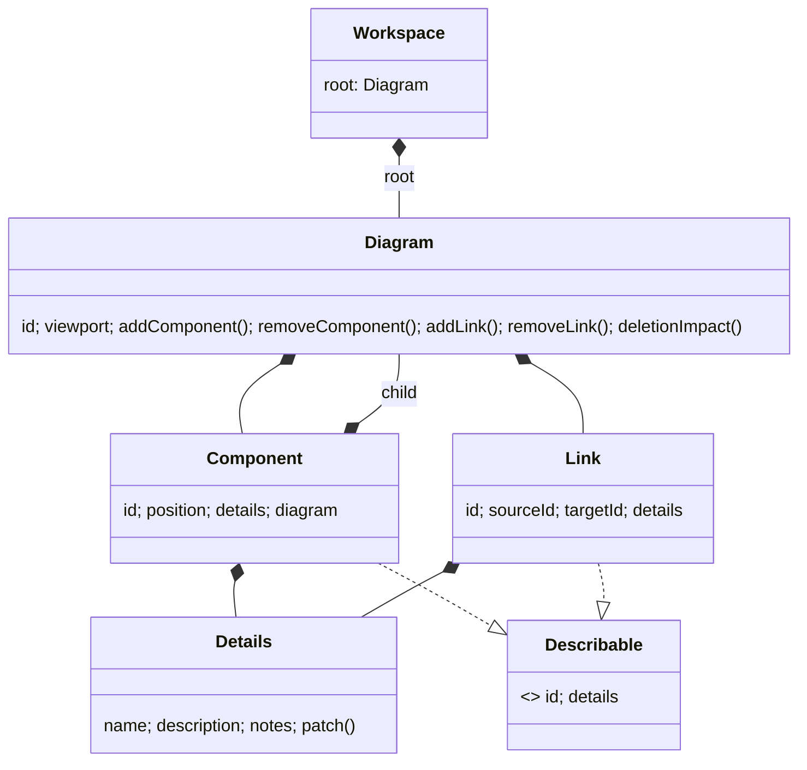

# Design Document

## Overview

Flow is a single-page, local-first React app. A framework-free TypeScript **domain model** (Workspace, Diagram, Component, Link) owns all rules: link validity, cascade deletion, navigation, and per-Diagram viewports. React is a thin view layer. `@xyflow/react` renders one Level at a time, and its nodes and edges are rebuilt 1:1 from the current Diagram. A `Repository` interface persists a serialized snapshot, with `LocalStorageRepository` as the only implementation.

Stack: TypeScript (strict), React, Vite, `@xyflow/react`, Vitest, fast-check, ESLint with typescript-eslint. IDs come from `crypto.randomUUID()`.

Design decisions:

| Decision | Rationale |
| --- | --- |
| Domain has no React imports | Rules are unit- and property-testable without a DOM. |
| One Level rendered at a time, no `parentId` nesting | Matches the "diagram inside a component" model. The canvas never holds more than one Diagram, so there is no sub-flow layout or hit-testing to manage. |
| Observable stores read via `useSyncExternalStore` | A subscribe method and a version number are enough. No state library is needed. |
| `Repository` is async | Lets IndexedDB replace localStorage later without changing callers. |
| Viewport stored on each Diagram | It is saved and restored with the data. Requirement 4.2 then needs no extra mechanism. |
| Navigation state is not persisted | Requirement 5.2 restores the Root Diagram. The open path is session state. |

## Architecture



Layers depend downward only. The domain knows nothing about the view or storage. A composition root (`main.tsx`) constructs the collaborators and passes them to React through a context provider.

## Components and Interfaces

### Domain

**ChangeSignal** (shared helper, composed, not inherited)
- Responsibility: hold a version number and a set of listeners.
- Interface: `subscribe(listener): () => void`, `get version(): number`, `notify(): void`.
- Used by: Workspace, Navigator, Notifier. Serves 5.1 and every requirement that needs the view to refresh.

**Scheduler** (interface, shared)
- `set(fn, ms): handle`, `cancel(handle)`. `TimerScheduler` wraps `setTimeout`/`clearTimeout`. Tests inject a fake.
- Used by: Notifier (auto-dismiss) and AutoSaver (debounce). One timer abstraction for both.

**ObservableStore** (interface)
- `subscribe(listener): () => void`, `getVersion(): number`.
- Contract the view hook depends on. Implemented by Workspace, Navigator, Notifier.

**Details** (value object, composed)
- Responsibility: name, description, notes, and validated patching.
- Interface: `name`, `description`, `notes`, `patch(partial): void`, `toJSON()`.
- Used by Component and Link. Serves 1.2, 3.2.

**Describable** (interface)
- `id: string`, `details: Details`.
- Implemented by Component and Link. The Inspector edits any Describable, so one editor covers both.

**Viewport** (value object)
- `{ x, y, zoom }`, default `{0, 0, 1}`. Serves 4.1, 4.2.

**Component** (implements Describable)
- Responsibility: a node with details, a position, and exactly one child Diagram.
- Interface: `id`, `details`, `position`, `setPosition(p)`, `diagram: Diagram`.
- Collaborators: Details, Diagram (composition).
- Serves 1.1, 1.2, 1.3, 2.1.

**Link** (implements Describable)
- Responsibility: a connection between two Component ids in one Diagram.
- Interface: `id`, `details`, `sourceId`, `targetId`.
- Immutable endpoints. Serves 3.1, 3.2.

**Diagram**
- Responsibility: own its Components and Links, and enforce every structural rule locally. Because only a Diagram's own Components are known to it, "same Diagram" is checked by id membership.
- Interface:
  - `id`, `viewport`, `setViewport(v)`
  - `components: readonly Component[]`, `links: readonly Link[]`, `component(id)`
  - `addComponent(position): Component`
  - `removeComponent(id): void` (cascades, see below)
  - `deletionImpact(id): { contents: number, links: number }`
  - `addLink(sourceId, targetId): Link` (throws `DomainError`)
  - `removeLink(id): void`
- Rules:
  - `removeComponent`, `deletionImpact` and `removeLink` throw `DomainError('NOT_IN_DIAGRAM')` for an id that is not in this Diagram.
  - `addLink` throws `DomainError('SELF_LINK')` when `sourceId === targetId`, and `DomainError('NOT_IN_DIAGRAM')` when either id is not a Component of this Diagram.
  - `removeComponent` removes the Component (and with it, its child Diagram and everything inside) plus every Link of this Diagram whose endpoint is that Component.
  - `deletionImpact` counts the descendants of the child Diagram (Components and Links, recursively) as `contents`, and the attached Links in this Diagram as `links`. The UI asks for confirmation only when `contents` is above zero.
- Collaborators: Component, Link, IdGenerator, a change callback supplied by the Workspace.
- Serves 1.1, 1.4, 1.5, 3.1, 3.3, 3.4, 4.2.

**Workspace** (implements ObservableStore)
- Responsibility: aggregate root. Holds the Root Diagram and turns any mutation anywhere in the tree into a single change notification.
- Interface: `root: Diagram`, `subscribe`, `getVersion`, plus `static empty(ids)` and `static restore(snapshot, ids)`.
- Mutations happen on Diagram, Component, Link and Details objects. Each is built with an `onChange` callback that the Workspace wires to its ChangeSignal, so no mutation can skip notification.
- Construction: `empty` and `restore` both build Diagrams through one private factory that supplies the change callback and the IdGenerator. `restore` walks a `WorkspaceSnapshot` and builds the whole Diagram tree through that factory, keeping the stored ids. Restored and newly created content therefore notify and generate ids identically. `restore` assumes a validated snapshot (see WorkspaceSerializer).
- The snapshot types (`WorkspaceSnapshot` and its DTOs, see Data Models) live in the domain, so the domain does not depend on persistence.
- Collaborators: Diagram, ChangeSignal, IdGenerator.
- Serves 5.1 (change notification) and all editing requirements.

**IdGenerator** (interface)
- `next(): string`. `UuidGenerator` uses `crypto.randomUUID()`. Tests inject a counter.

**DomainError**
- `code: 'SELF_LINK' | 'NOT_IN_DIAGRAM'`, `message`. The view maps `message` to the user-facing reason (3.4).

**Navigator** (implements ObservableStore)
- Responsibility: the current Level as a path of Component ids from the root.
- Interface: `path: readonly string[]` (Component ids only, no names), `trail(): readonly Component[]` (the path resolved to live Components), `current: Diagram`, `open(componentId)`, `navigateTo(index)`.
- Names are never copied into the path. The Breadcrumb reads `trail()[i].details.name`, so a rename shows immediately.
- Rules: `open` accepts only a Component of the current Diagram and throws `DomainError('NOT_IN_DIAGRAM')` otherwise. `trail` throws the same error if a path id no longer resolves. `navigateTo(i)` keeps the first `i` path elements (index 0 is the root) and throws `RangeError` for a non-integer or out-of-range index.
- Deleting a Component never invalidates the path, because the path holds ancestors of the current Diagram and deletion only targets the current Diagram's own Components.
- Collaborators: a root provider, `{ readonly root: Diagram }` (the Workspace in the app). Depending on this narrow shape lets tests skip building a Workspace.
- Serves 2.1, 2.2, 2.3, 2.4, 4.2.

### Persistence

**Repository** (interface)
- `load(): Promise<unknown | null>` (raw parsed data, `null` when nothing is stored), `save(snapshot: WorkspaceSnapshot): Promise<void>`. Throws `PersistenceError` on failure.

**LocalStorageRepository** (implements Repository)
- Stores `JSON.stringify(snapshot)` under a single key (`flow.workspace`). Takes a `Storage` in its constructor for testing. Wraps quota and parse errors in `PersistenceError`. Serves 5.1, 5.2, 5.4, 5.5.

**WorkspaceSerializer**
- Responsibility: convert between a Workspace and plain data. It never builds domain objects.
- Interface: `serialize(workspace): WorkspaceSnapshot`, `deserialize(raw: unknown): WorkspaceSnapshot` (validates and returns plain data).
- `deserialize` throws `PersistenceError` for an unknown `schemaVersion`, a malformed shape, or a dangling link endpoint. `Workspace.restore` then builds the tree. Serves 5.2, 5.5.

**WorkspaceLoader**
- Responsibility: startup load. Returns `{ workspace, canSave }`.
- Interface: `load(): Promise<{ workspace: Workspace, canSave: boolean }>`.
- Behavior: no stored data gives `Workspace.empty(ids)` with `canSave: true`. Readable data gives `Workspace.restore(serializer.deserialize(raw), ids)` with `canSave: true`. If `load` or `deserialize` throws `PersistenceError`, it returns an empty Workspace with `canSave: false` and posts a persistent `load` message to the Notifier. `main.tsx` starts AutoSaver only when `canSave` is true, so unreadable data is not overwritten.
- Collaborators: Repository, WorkspaceSerializer, IdGenerator, Notifier.
- Serves 5.2, 5.5.

**AutoSaver**
- Responsibility: save after changes with a trailing debounce.
- Interface: constructor `(workspace, serializer, repository, notifier, scheduler, pageEvents?)`, `start(): void`, `flush(): Promise<void>`, `stop(): void`. `pageEvents` is an `EventTarget` that defaults to `window` and is undefined outside a browser.
- Behavior: subscribes to the Workspace and schedules a save 500 ms after the last change, with a maximum wait of 900 ms so continuous editing still saves inside 1 second (see Error Handling). It calls `flush` on `pagehide` of `pageEvents`. A `dirty` flag is set on every change and stays set after a failed save, so a later `flush` retries. Saves are serialized through a promise queue, and each serializes the workspace when it runs, so a slow earlier write cannot overwrite a newer one. `flush` cancels both timers. On failure it posts a persistent `save` message to the Notifier; on the next success it clears it.
- Collaborators: Workspace, WorkspaceSerializer, Repository, Notifier, Scheduler.
- Serves 5.1, 5.3.

**Notifier** (implements ObservableStore)
- Responsibility: hold user-visible messages keyed by id, with a lifetime per kind.
- Types: `Message = { key, text, kind: 'transient' | 'persistent' }`.
- Interface: `post(key, text, kind)`, `clear(key)`, `messages: readonly Message[]`. The constructor takes a `Scheduler` and a transient timeout (default 5000 ms).
- Rules:
  - Posting under an existing key replaces that message. For a transient message it also restarts the timer.
  - A transient message auto-clears after the timeout, and `clear(key)` also cancels its timer. NotificationBar shows a dismiss button on transient messages that calls `clear`.
  - A persistent message stays until `clear` is called.
- Keys in use: `link` (transient, rejected link, so a newer rejection replaces the older), `save` (persistent, cleared by AutoSaver on the next successful save), `load` (persistent, unreadable stored data).
- Serves 3.4, 5.3, 5.5.

### View (React)

**useStore(store)** hook
- `useSyncExternalStore(store.subscribe, store.getVersion)`, returns the store. The single bridge from domain to React.

**AppProvider**
- React context supplying Workspace, Navigator, Notifier, read with `useApp()`. Constructed in `main.tsx` (dependency injection). DeleteFlow is not in the context; App owns it.

**DiagramProjector**
- Responsibility: stateless mapping from a Diagram to React Flow `nodes` and `edges`, one node per Component and one edge per Link, with the same ids.
- Interface: `toNodes(diagram)`, `toEdges(diagram)`.
- Serves 1.1, 3.1, 3.3 (rendering side).

**CanvasView**
- Responsibility: host `ReactFlow` for `navigator.current`. `CanvasView` reads the Navigator and renders an inner `Level` keyed by Diagram id, so the canvas remounts on Level change and applies `defaultViewport` from the Diagram (4.2).
- Props: `deleteFlow`, `onSelectionChange(selection)`.
- Behavior (in `Level`):
  - Nodes and edges come from DiagramProjector. React Flow keeps local state for drags and selection, and `Level` rebuilds it from the Diagram on each Workspace version, carrying the `selected` flags over so a rename keeps the selection.
  - `onNodeDragStop` calls `component.setPosition` (1.3).
  - `onMoveEnd` calls `diagram.setViewport(viewport)` (4.1, 4.2).
  - `onConnect` calls `diagram.addLink`. It catches `DomainError` and posts the reason to the Notifier as a transient message under key `link` (3.4).
  - Double-click on a node calls `navigator.open` (2.1). `zoomOnDoubleClick` is disabled so it does not also zoom.
  - Delete key: `onBeforeDelete` calls `DeleteFlow.request` for each Component, and for each Link not attached to a deleted Component, then returns `false` so React Flow never deletes by itself.
  - `onSelectionChange` reports exactly one selected Component or Link, otherwise `null`. The selection itself is kept in App, which resolves the live item each render and drops a stale one.
- Collaborators: Navigator, DiagramProjector, Notifier, DeleteFlow.

**Inspector**
- Edits name, description, and notes of the selected `Describable` (Component or Link) through `details.patch` (1.2, 3.2). It also exposes Delete for the selection.

**DeleteFlow** (implements ObservableStore, no React imports)
- Responsibility: single path for deleting a Component or Link. For a Component, read `deletionImpact`. If `contents > 0`, hold a `pending` deletion for ConfirmDialog (1.5), then call `removeComponent` on confirm (1.4). Links delete directly (3.3).
- Interface: `request(diagram, { kind, id })`, `confirm()`, `cancel()`, `pending: PendingDelete | null`.
- App owns one instance and passes it to CanvasView, Inspector and ConfirmDialog, so the Delete key and the Inspector share one pending confirmation.

**ConfirmDialog**, **Breadcrumb** (renders the Root label plus `navigator.trail()` names from the live Components, subscribed to both Navigator and Workspace so renames appear at once, calls `navigateTo`, 2.2 and 2.3), **NotificationBar** (renders Notifier messages and a dismiss button on transient ones, 3.4, 5.3 and 5.5), **Toolbar** (adds a Component at the canvas center, 1.1).

### Startup sequence



## Data Models

```ts
type Position = { x: number; y: number };
type ViewportDto = { x: number; y: number; zoom: number };
type DetailsDto = { name: string; description: string; notes: string };

type WorkspaceSnapshot = { schemaVersion: 1; root: DiagramDto };
type DiagramDto = {
  id: string;
  viewport: ViewportDto;
  components: ComponentDto[];
  links: LinkDto[];
};
type ComponentDto = { id: string; details: DetailsDto; position: Position; diagram: DiagramDto };
type LinkDto = { id: string; details: DetailsDto; sourceId: string; targetId: string };
```

These types live in `src/domain` so that `Workspace.restore` can consume them. The snapshot is a nested tree that mirrors the model. Each Link lives in the DiagramDto that contains both of its endpoints, so the "same Diagram" rule holds by structure. New Components start with an empty name, description, and notes, and an empty child Diagram with the default viewport.



## Correctness Properties

*A property is a characteristic or behavior that should hold true across all valid executions of a system-essentially, a formal statement about what the system should do. Properties serve as the bridge between human-readable specifications and machine-verifiable correctness guarantees.*

The generator for these properties builds a random Workspace by applying random sequences of domain commands (add Component, add Link, remove, open) to an empty Workspace. This yields nested trees of random depth.

### Property 1: Created Components start empty

*For any* Diagram in any workspace, adding a Component at any position SHALL add exactly one Component to that Diagram, at that position, with an empty child Diagram.

**Validates: Requirements 1.1**

### Property 2: Edits are read back unchanged

*For any* Component or Link, any partial update of name, description, or notes SHALL change exactly the given fields and preserve the others, and *for any* position, `setPosition` SHALL make `position` equal to it.

**Validates: Requirements 1.2, 1.3, 3.2**

### Property 3: Valid links are created, and removal restores the link set

*For any* Diagram and any two distinct Components of it, `addLink` SHALL add one Link between them, and `removeLink` of that Link SHALL restore the previous set of Links.

**Validates: Requirements 3.1, 3.3**

### Property 4: Invalid links are rejected and change nothing

*For any* workspace, any link from a Component to itself, and any link between Components that are not both in the same Diagram, `addLink` SHALL throw a `DomainError` with a reason, and the serialized workspace SHALL be unchanged.

**Validates: Requirements 3.4**

### Property 5: Deletion cascades and keeps references intact

*For any* workspace and any Component, `removeComponent` SHALL remove that Component, its entire child tree, and every Link attached to it, and afterwards every Link in the workspace SHALL reference Components of its own Diagram.

**Validates: Requirements 1.4**

### Property 6: Deletion impact matches what is deleted

*For any* workspace and any Component, `deletionImpact` SHALL report `links` equal to the number of Links removed from the Component's Diagram and `contents` equal to the number of Components and Links removed from its subtree.

**Validates: Requirements 1.5**

### Property 7: Navigation follows the nesting

*For any* workspace and any sequence of `open` calls on Components of the current Diagram, `current` SHALL be the opened Component's Diagram and `path` SHALL list the ids of the opened Components in order (ids only, no names), to any depth. *For any* index in the path, `navigateTo(index)` SHALL make `current` the Diagram at that depth and truncate the path to match.

**Validates: Requirements 2.1, 2.2, 2.3, 2.4**

### Property 8: Viewports survive navigation

*For any* workspace, any Diagram, and any viewport set on it, navigating away and back SHALL leave the Diagram's viewport equal to the value that was set.

**Validates: Requirements 4.2**

### Property 9: Serialization round trip

*For any* workspace (including Component details, positions, Links, viewports, and nesting), `serialize(Workspace.restore(deserialize(JSON.parse(JSON.stringify(serialize(w))))))` SHALL equal `serialize(w)`. The same holds through `LocalStorageRepository` backed by an in-memory `Storage`.

**Validates: Requirements 5.2, 4.2**

## Error Handling

| Situation | Handling | Requirement |
| --- | --- | --- |
| Self link or link across Diagrams | `Diagram.addLink` throws `DomainError`. `CanvasView.onConnect` catches it and posts the reason to the Notifier as a transient message (key `link`, auto-dismiss after about 5 s, user-dismissable, replaced by a newer rejection). The model stays unchanged. React Flow can only connect nodes it renders, so a cross-Diagram link is not reachable from the UI, but the domain still enforces it. | 3.4 |
| Save fails (quota, storage disabled) | Repository throws `PersistenceError`. AutoSaver posts a persistent "changes are not saved" message under key `save`, retries on the next change, and clears the message on success. Domain state is not rolled back. | 5.3 |
| Saves under continuous editing | The debounce is 500 ms. AutoSaver also enforces a maximum wait: if a save has been pending for 900 ms, it saves immediately rather than waiting for a quiet period. | 5.1 |
| Stored data is corrupt or has an unknown `schemaVersion` | `load`/`deserialize` throws `PersistenceError`. `WorkspaceLoader` returns an empty Workspace with `canSave: false` and posts a persistent `load` message. `main.tsx` does not start AutoSaver, so the unreadable stored data is not overwritten. | 5.5 |
| Unknown ids passed to domain methods | Throw `DomainError('NOT_IN_DIAGRAM')`. These indicate programmer error and are not user-facing. | 3.4 |
| Delete with contents | `DeleteFlow` requires confirmation. Cancel leaves the model unchanged. | 1.5 |

## Testing Strategy

Property-based testing applies to the domain and serializer, which are pure in-memory logic with large input spaces. It does not apply to the React view, the `localStorage` calls, or timing, which use example-based tests.

**Property tests** (Vitest + fast-check, in `src/domain/**.property.test.ts`):
- One property test per Correctness Property above, each with at least 100 runs.
- Each test carries a tag comment in the form `Feature: flow, Property N: <title>`.
- A shared arbitrary builds random workspaces by applying random command sequences, using a counter-based `IdGenerator` for deterministic shrinking.

**Unit tests** (Vitest):
- `AutoSaver` with a fake `Scheduler`: first save within 1 second of a change (5.1), bursts coalesce to one save, maximum wait holds, `flush` on `pagehide`.
- `AutoSaver` with a failing Repository: Notifier holds the save message, then clears after a later success (5.3).
- `LocalStorageRepository` with a fake `Storage` that throws on `setItem` (quota) and returns malformed JSON.
- `WorkspaceSerializer` rejects unknown `schemaVersion`, malformed shape and dangling link endpoints.
- `Workspace.restore`: a restored nested Component notifies on change and new Components get fresh ids, like new content.
- `WorkspaceLoader`: empty when nothing is stored, restored when readable, and for unreadable data an empty Workspace, `canSave: false` and a `load` message (5.5).
- `Navigator.trail` resolves live names after a rename (2.2).
- `DiagramProjector` returns one node per Component and one edge per Link with matching ids.
- `DeleteFlow` shows the dialog only when `contents > 0` and deletes only after confirm (1.5).
- `Notifier` with a fake `Scheduler`: post, clear, replace by key, a transient message auto-clears after the timeout, replacing it restarts the timer, a persistent message never auto-clears.

**Not tested here**: React Flow's own pan and zoom behavior (4.1). Playwright and DOM-based tests are deferred until after the MVP.

**Lint**: ESLint with typescript-eslint, strict TypeScript, and a rule that blocks imports from `react` and `@xyflow/react` inside `src/domain` and `src/persistence`.

## Requirements Traceability

| Requirement | Components |
| --- | --- |
| 1.1 Create Component | Diagram, Component, Toolbar, CanvasView, DiagramProjector, IdGenerator |
| 1.2 Edit details | Details, Describable, Inspector |
| 1.3 Move | Component, CanvasView |
| 1.4 Delete cascade | Diagram, DeleteFlow |
| 1.5 Confirm delete | Diagram.deletionImpact, DeleteFlow, ConfirmDialog |
| 2.1 Open Component | Navigator, CanvasView |
| 2.2 Path | Navigator, Breadcrumb |
| 2.3 Select path element | Navigator, Breadcrumb |
| 2.4 Any depth | Component (owns Diagram), Navigator |
| 3.1 Create Link | Diagram, Link, CanvasView, DiagramProjector |
| 3.2 Edit Link | Details, Describable, Inspector |
| 3.3 Delete Link | Diagram, DeleteFlow |
| 3.4 Reject Link | Diagram, DomainError, Notifier, NotificationBar |
| 4.1 Pan and zoom | CanvasView, Viewport |
| 4.2 Restore view | Viewport, Diagram, CanvasView (keyed remount), WorkspaceSerializer |
| 5.1 Save within 1 s | AutoSaver, Scheduler, ChangeSignal, Workspace, Repository |
| 5.2 Restore on open | Repository, LocalStorageRepository, WorkspaceSerializer, Workspace.restore, WorkspaceLoader, main.tsx |
| 5.3 Save failure notice | AutoSaver, Notifier, NotificationBar |
| 5.4 No backend | LocalStorageRepository (only implementation) |
| 5.5 Unreadable stored data | WorkspaceLoader, WorkspaceSerializer, Notifier, NotificationBar, main.tsx |

Every component above traces to at least one requirement. Infrastructure pieces (ChangeSignal, ObservableStore, Scheduler, useStore, AppProvider) serve all requirements that need view refresh or timers and are listed under 5.1.

## Open Points

1. **Maximum wait** on saves (Error Handling) is a design guard for 5.1, which requires a save within 1 second of a change even during continuous editing.
