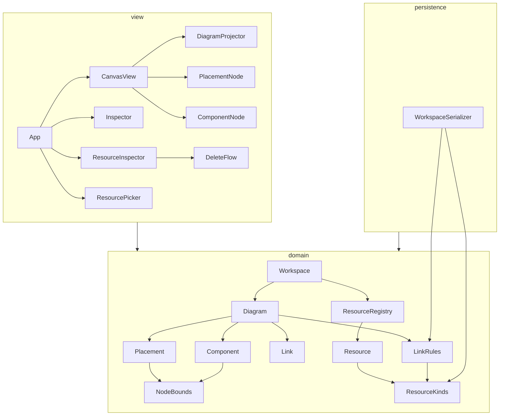

# Design Document

## Overview

Resources are shared definitions held by the Workspace. A Placement is a leaf node in a Diagram that points at one Resource by id. Links may now end on a Placement. Port ids stay `string`; no Link end is ever null.

Three decisions shape the design:

1. **Every Link end stores a string id.** A Component end carries a real output port id as source or a real input port id as target. A `database` end carries `read` (source) or `write` (target). A four-sided Placement (`user`, `artifact`, `input-object`) carries one of the side ids `top`, `right`, `bottom`, `left`, with no direction rule. The side id is stored on the Link, so the anchor survives reload and undo. Any kind may link to any kind.
2. **Component and Placement ids share one namespace per Diagram.** `Link.sourceId` and `targetId` can name either, so the existing id-based plumbing (React Flow node ids, paste id remapping, `touches`) keeps working.
3. **Kind-specific behaviour has one home.** A `ResourceKinds` table says whether a kind is typed and which handle ids it has as a Link source and as a Link target. The domain rules, the serializer and the view all read it.

## Architecture



`src/domain` and `src/persistence` stay free of `react` and `@xyflow/react`.

## Components and Interfaces

### Domain

#### ResourceKinds (new, `ResourceKinds.ts`)

Responsibility: the single description of each Resource Kind. Used by Requirements 1.2, 2.1 to 2.5, 3.4, 4.2, 8.3, 10.

```ts
export type ResourceKind = 'database' | 'artifact' | 'user' | 'input-object'

export const DATABASE_PORTS = { read: 'read', write: 'write' } as const
export const SIDE_PORTS = ['top', 'right', 'bottom', 'left'] as const

export type KindSpec = {
  readonly typed: boolean // artifact and input-object carry a Data Type
  readonly sourceIds: readonly string[] // handle ids valid on a Link source end
  readonly targetIds: readonly string[] // handle ids valid on a Link target end
}

export const RESOURCE_KINDS: Record<ResourceKind, KindSpec> = {
  database: { typed: false, sourceIds: ['read'], targetIds: ['write'] },
  artifact: { typed: true, sourceIds: SIDE_PORTS, targetIds: SIDE_PORTS },
  user: { typed: false, sourceIds: SIDE_PORTS, targetIds: SIDE_PORTS },
  'input-object': { typed: true, sourceIds: SIDE_PORTS, targetIds: SIDE_PORTS },
}
export const isResourceKind = (v: unknown): v is ResourceKind => typeof v === 'string' && v in RESOURCE_KINDS
```

#### Resource and ResourceRegistry (new)

`Resource` has `id`, `kind`, `name`, `typeId: string | null`. Its constructor rejects a typed kind without a `typeId` and an untyped kind with one (`INVALID_RESOURCE`). `setName` and `setType` call the injected `onChange`, as `Component.setPosition` does. `setType` on an untyped kind throws `INVALID_RESOURCE`.

`ResourceRegistry` is a plain ordered collection with no notifications. Only `Workspace` changes its membership, so a multi-part operation can notify once.

```ts
export class Resource {
  constructor(id: string, kind: ResourceKind, name: string, typeId: string | null, onChange: () => void)
  readonly id: string
  readonly kind: ResourceKind
  get name(): string
  get typeId(): string | null
  setName(name: string): void
  setType(typeId: string): void // typed kinds only
}

export class ResourceRegistry {
  constructor(resources?: readonly Resource[])
  get all(): readonly Resource[]
  get(id: string): Resource | undefined
  byKind(kind: ResourceKind): readonly Resource[] // Picker list
  add(resource: Resource): void
  remove(id: string): void
}
```

#### NodeBounds and Placement (new)

`NodeBounds` owns position, optional size, `setPosition` and `setBounds`, each calling `onChange`. `Component` delegates to it with its public API unchanged. `Placement` composes it. This removes the duplicate that adding a second node type would otherwise create.

```ts
export interface Positioned {
  readonly id: string
  readonly position: Readonly<Position>
  readonly size: Readonly<Size> | undefined
  setPosition(p: Position): void
  setBounds(p: Position, s: Size): void
}

export class Placement implements Positioned {
  constructor(id: string, resourceId: string, position: Position, onChange: () => void, size?: Size)
  readonly resourceId: string
}
```

A Placement has no `Details`, no inner Diagram and no exceptions, so it is not `Describable`.

#### LinkRules (new, `LinkRules.ts`)

Responsibility: decide whether a Link between two endpoints is valid. `Diagram.addLink` and `WorkspaceSerializer` both call it, so a stored Link obeys exactly the rule the UI enforces. It works on small structural shapes, not classes, so the serializer can pass DTO data.

```ts
export type EndShape =
  | { kind: 'component'; inputIds: readonly string[]; outputIds: readonly string[] }
  | { kind: 'placement'; resource: ResourceKind }

// Returns the failure, or null when the Link is valid.
export function checkLink(
  source: EndShape, sourcePortId: string,
  target: EndShape, targetPortId: string,
): { code: 'INVALID_PORT'; message: string } | null
```

Rules:

| End | As source | As target |
|---|---|---|
| Component | `sourcePortId` is one of its output ids | `targetPortId` is one of its input ids |
| Placement, database | `sourcePortId` is `read` | `targetPortId` is `write` |
| Placement, four-sided | `sourcePortId` is one of `top`, `right`, `bottom`, `left` | `targetPortId` is one of `top`, `right`, `bottom`, `left` |

Placement ends read `RESOURCE_KINDS[kind].sourceIds` and `targetIds`. There is no rule on which kinds may link, so Placement to Placement Links are valid.

#### Diagram (changed)

New state `_placements: Placement[]`. `DiagramContext` gains `resources: ResourceLookup`, where `ResourceLookup` is `{ get(id): Resource | undefined }`, so a Diagram can read a Placement's kind without depending on `Workspace`.

```ts
get placements(): readonly Placement[]
placement(id: string): Placement | undefined
positioned(id: string): Positioned | undefined // Component or Placement, for drag and resize
addPlacement(resourceId: string, position: Position): Placement // NOT_IN_DIAGRAM style error if resource is unknown: MISSING_RESOURCE
removePlacement(id: string): void // also removes attached Links; keeps the Resource
dropPlacementsOf(resourceId: string): void // no notify; used by Workspace.removeResource
countPlacementsOf(resourceId: string): { placements: number; links: number } // this Diagram only
addAll(components, placements, links): void // one notification
addLink(sourceId, targetId, sourcePortId: string, targetPortId: string): Link
```

`addLink` keeps the `SELF_LINK` and `NOT_IN_DIAGRAM` checks, resolves each id to a Component or Placement, builds an `EndShape` for each, and calls `checkLink`. `removeComponent` and `deletionImpact` stay as they are. `countDescendants` also counts Placements, so deleting a Component warns about the Placements inside it.

#### Workspace (changed)

New state `_resources: ResourceRegistry`. It passes the registry to `DiagramContext.resources`. New public surface:

```ts
get resources(): ResourceRegistry
// Resource and Placement in one notification, so Requirement 3.3 is one undo step.
createPlacedResource(diagram: Diagram, spec: { kind: ResourceKind; name: string; typeId?: string }, position: Position): Placement
setResourceType(id: string, typeId: string): void // checks the catalog
resourceImpact(id: string): { placements: number; links: number } // across every Diagram
removeResource(id: string): void // Cascade Delete, one notification
```

`createPlacedResource` throws `TYPE_REQUIRED` when a typed kind has no `typeId`, `NO_TYPES` when the catalog is empty, and `UNKNOWN_TYPE` when `typeId` is not in the catalog. It validates before it mutates. Renaming goes through `Resource.setName`.

`removeResource` visits every Diagram (a new private `allDiagrams()` beside `allComponents()`), calls `dropPlacementsOf`, removes the Resource, and notifies once.

`isTypeInUse` also returns true when `_resources` has a Resource with that `typeId`. The `TYPE_IN_USE` message becomes "This type is used by a port or resource."

`toSnapshot` writes `schemaVersion: 8`, `resources`, and per-Diagram `placements`. `replaceContent` rebuilds the registry and Placements. `capture()` needs no change, since it serializes `toSnapshot(false)`, so History includes Resources and Placements automatically (Requirement 9.1).

`copy(diagram, nodeIds)` returns the selected Components and Placements and the Links with both ends selected. `paste` first checks that every Placement in the fragment, including those nested in Components, references a Resource in the registry. If one does not, it throws `MISSING_RESOURCE` before changing anything. Otherwise it remaps ids and calls `Diagram.addAll`. `withFreshIds` gives Placements new ids from the same `renamed` map as Components, so Link ends follow. Port ids are copied as they are.

#### Snapshot types (changed)

```ts
export type ResourceDto = { id: string; kind: ResourceKind; name: string; typeId: string | null }
export type PlacementDto = { id: string; resourceId: string; position: Position; size?: Size }
export type DiagramDto = { /* … */ placements: PlacementDto[] }
export type WorkspaceSnapshot = { schemaVersion: 8; /* … */ resources: ResourceDto[] }
export type Fragment = { components: ComponentDto[]; placements: PlacementDto[]; links: LinkDto[] }
```

`DomainError` codes added: `MISSING_RESOURCE`, `INVALID_RESOURCE`, `TYPE_REQUIRED`, `NO_TYPES`, `UNKNOWN_TYPE`.

### Persistence

`WorkspaceSerializer.deserialize` changes:

- Accepts only `schemaVersion === 8`.
- Parses `resources` first, rejecting an unknown kind, a typed kind without a `typeId`, an untyped kind with one, or a `typeId` not in the type catalog.
- `parseDiagram` receives a `ReadonlyMap<string, ResourceKind>`. It parses Placements, rejects a `resourceId` not in the map, and treats Placement and Component ids as one set.
- Link ends are checked with `checkLink`, using an `EndShape` built from each DTO. This replaces the inline output and input check.

### View

- **DiagramProjector.** `toNodes` also returns one node per Placement with `type: 'resource'` and `data: { resourceId }`. `toEdges` passes the stored port ids straight through as `sourceHandle` and `targetHandle`, so an edge anchors on the exact handle the user used, including after reload and undo.
- **PlacementNode (new).** Renders the kind icon, the Resource name, and for typed kinds the Data Type name. A database shows two handles with ids `read` and `write`. The other kinds show four side handles with the fixed ids `top`, `right`, `bottom`, `left` (`SIDE_PORTS`), and no typed ports. Each side overlays a source and a target Handle with the same id, and the canvas uses loose connection mode, so the user can start or end a Link on any side. It reuses `NodeResizer` and the stored-size-as-floor logic from `ComponentNode`. Registered in `nodeTypes` in `CanvasView`.
- **resourceIcons (new, `resourceIcons.tsx`).** One icon per `ResourceKind`, used by `PlacementNode`, the palette and `ResourcePicker`. `user` uses the C4 person glyph.
- **CanvasView (changed).**
  - `onConnect` passes the connection's handle ids to `diagram.addLink` unchanged. `checkLink` is the only validator.
  - Drag, selection-drag and resize handlers call `diagram.positioned(id)` instead of `diagram.component(id)`.
  - `CanvasSelection` gains `kind: 'placement'`.
  - The palette and context menu call `ResourcePicker`.
  - Copy, paste and duplicate use the extended `Fragment`.
  - `onBeforeDelete` sends Placement nodes to `DeleteFlow` with `kind: 'placement'`.
- **ResourcePicker (new).** A dialog for one `ResourceKind`. It lists `workspace.resources.byKind(kind)` and offers a create form. For typed kinds the form has a required Data Type select. When the catalog is empty it shows "Add a Data Type first" and disables creation. Choosing an existing Resource calls `diagram.addPlacement`. Creating calls `workspace.createPlacedResource`.
- **ResourceInspector (new).** For a selected Placement. Shows the Resource name, a Data Type select for typed kinds, a "Delete" button and a "Delete resource" button. App renders it in place of `Inspector` when the selection is a Placement. `App`'s `selection` state becomes `{ diagramId; kind: 'component' | 'placement'; id }`.
- **DeleteFlow (changed).** `DeleteTarget.kind` gains `'placement'` and `'resource'`. A `placement` deletes at once. A `resource` computes `workspace.resourceImpact(id)` and sets a pending confirmation. `PendingDelete` becomes `{ subject: 'component' | 'resource'; counts; run(): void }`, so `confirm()` calls `run()` and cancel leaves the Workspace untouched. `DeleteFlow` receives the Workspace through its constructor.
- **ConfirmDialog (changed).** Chooses its message by `pending.subject`. The resource message gives the Placement and Link counts from Requirement 5.2.
- **pasteOffset (changed).** `offsetToCenter` includes Placements in the bounding box, with a default Placement size when none is stored.

### Test support

`workspaceArbitrary.ts` gains commands, all resolved by modulo picks like the existing ones:

```ts
| { kind: 'addResource'; resourceKind: ResourceKind; name: string; type: number; diagram: number; position: Position }
| { kind: 'addPlacement'; diagram: number; resource: number; position: Position }
| { kind: 'removePlacement'; diagram: number; placement: number }
| { kind: 'movePlacement'; diagram: number; placement: number; position: Position; size?: Size }
| { kind: 'renameResource'; resource: number; name: string }
| { kind: 'retypeResource'; resource: number; type: number }
| { kind: 'removeResource'; resource: number }
| { kind: 'addResourceLink'; diagram: number; component: number; placement: number; port: number; direction: 'out' | 'in' }
| { kind: 'addPlacementLink'; diagram: number; source: number; target: number; sourcePort: number; targetPort: number }
```

`addResource` calls `createPlacedResource`. `addResourceLink` picks a real Component port and a handle id valid for the picked direction (`read` or `write` for a database, any side id otherwise). `addPlacementLink` links two Placements, picking `read`/`write` for a database source/target and any side id otherwise. `applyCommand` skips commands with no valid target, as it does today.

## Data Models

Snapshot v8 (abridged):

```json
{
  "schemaVersion": 8,
  "types": [{ "id": "t1", "name": "string" }],
  "exceptions": [], "environmentVariables": [],
  "resources": [
    { "id": "r1", "kind": "database", "name": "Orders", "typeId": null },
    { "id": "r2", "kind": "artifact", "name": "Invoice", "typeId": "t1" }
  ],
  "root": {
    "id": "d0", "viewport": { "x": 0, "y": 0, "zoom": 1 },
    "components": [ /* … */ ],
    "placements": [{ "id": "p1", "resourceId": "r1", "position": { "x": 10, "y": 20 } }],
    "links": [{ "id": "l1", "sourceId": "c1", "targetId": "p1", "sourcePortId": "port-uuid", "targetPortId": "write", "details": { /* … */ } }]
  }
}
```

Invariants of a valid Workspace:

- Every Placement's `resourceId` is in `resources`.
- Every typed Resource's `typeId` is in `types`. Every untyped Resource has `typeId: null`.
- Every Link's two ends are nodes of the same Diagram, and `checkLink` accepts them.

## Error Handling

| Condition | Where | Result |
|---|---|---|
| Self link, other-Diagram end, port or handle id the end does not have in that role | `Diagram.addLink` via `checkLink` | `DomainError` (`SELF_LINK`, `NOT_IN_DIAGRAM`, `INVALID_PORT`). `CanvasView.onConnect` posts the message to the Notifier, as today. |
| Typed Resource created without a type | `Workspace.createPlacedResource` | `TYPE_REQUIRED`. The Picker blocks submit, so this is the domain backstop. |
| Typed Resource created with an empty catalog | same | `NO_TYPES`. The Picker shows the message and creates nothing. |
| Remove a Data Type in use | `Workspace.removeType` | `TYPE_IN_USE`, type kept. |
| Paste references a deleted Resource | `Workspace.paste` | `MISSING_RESOURCE`, nothing pasted. `CanvasView` posts the message. |
| Add Placement of unknown Resource | `Diagram.addPlacement` | `MISSING_RESOURCE`. |
| Stored data has another `schemaVersion`, a Dangling Reference, or a Link end outside its Diagram | `WorkspaceSerializer` | `PersistenceError`. The loader starts empty and leaves stored data unchanged, as today. |

Every domain operation validates before it mutates, so a rejected operation fires no notification and records no undo step.

## Testing Strategy

Property tests (fast-check, at least 100 runs each) run against the pure domain and persistence code. UI rendering uses example tests only. Each property test carries the tag `Feature: resource-nodes, Property N: <title>`.

Unit and example tests:

- `ResourceKinds`: every kind has an entry and an icon.
- `ResourceRegistry.byKind` and `Resource` constructor invariants.
- `Diagram.addPlacement`, `removePlacement`, and two Placements of one Resource in two Diagrams (1.3, 3.2).
- `Workspace.createPlacedResource` with an empty catalog (3.5).
- `DeleteFlow`: placement deletes at once, resource goes pending with counts, cancel changes nothing, confirm is one step (5.1 to 5.4).
- `DiagramProjector`: Placement nodes and stored handle ids on edges. `PlacementNode` handle ids per kind (2.2, 2.3).
- Paste after the Resource was deleted (7.4).
- Existing tests that assert `schemaVersion: 7` or call `addLink` with string ports are updated.

Property tests go in new files `resources.property.test.ts`, `resourceLinks.property.test.ts`, and in the extended `history.property.test.ts` and `persistence/roundTrip.property.test.ts`.

## Correctness Properties

*A property is a characteristic or behavior that should hold true across all valid executions of a system-essentially, a formal statement about what the system should do. Properties serve as the bridge between human-readable specifications and machine-verifiable correctness guarantees.*

### Property 1: Resource creation respects the type rule

For any Resource Kind, any type catalog (including an empty one), and any optional Data Type choice, `createPlacedResource` either throws and leaves the Workspace unchanged, or succeeds. When it succeeds, the Resource has a non-null `typeId` in the catalog if and only if its kind is `artifact` or `input-object`, and a Placement of it exists in the Diagram. It succeeds for a typed kind if and only if a catalog type was chosen.

**Validates: Requirements 1.2, 3.4, 3.5**

### Property 2: Resource edits reach every Placement

For any Workspace and any rename or retype of a Resource, the new snapshot differs from the old one only in that Resource's entry. Every Placement of the Resource is unchanged and still references it.

**Validates: Requirements 1.5, 4.3**

### Property 3: Placement bounds are kept

For any Placement and any position and size, after `setBounds` or `setPosition` the snapshot holds those values on that Placement, and every other node is unchanged.

**Validates: Requirements 1.4**

### Property 4: Accepted Links have the right end ids

For any Workspace and any Link accepted by `addLink`, including a Link between two Placements, a Component end carries an id from its outputs when it is the source and from its inputs when it is the target. A `database` end carries `read` as source or `write` as target. A `user`, `artifact` or `input-object` end carries one of `top`, `right`, `bottom`, `left` in either role. Every port id is a string.

**Validates: Requirements 2.1, 2.2, 2.3, 2.4**

### Property 5: Invalid Links are rejected without change

For any Workspace and any attempted Link that is a self link, has an end in another Diagram, or names a port or handle id the end does not have in that role (including `write` as a database source, `read` as a database target, and an unknown side id), `addLink` throws a `DomainError`, the Diagram is unchanged, and no notification fires.

**Validates: Requirements 2.5**

### Property 6: Placement deletion keeps the Resource

For any Placement, `removePlacement` removes that Placement and the Links attached to it. The Resource, every other node and every other Link remain.

**Validates: Requirements 5.1**

### Property 7: Cascade Delete matches its warning and is one step

For any Workspace and any Resource, `resourceImpact` equals the number of Placements and Links that `removeResource` then removes. Afterwards no Placement in any Diagram references the Resource, no Link touches a removed Placement, all other content is unchanged, and exactly one notification fired.

**Validates: Requirements 5.2, 5.3**

### Property 8: A Data Type in use cannot be removed

For any Workspace and any Data Type, `removeType` throws `TYPE_IN_USE` and keeps the type if and only if some Component port, Link port or typed Resource references it. Otherwise it removes the type.

**Validates: Requirements 6.1, 6.2**

### Property 9: Copy and paste reuse Resources

For any Diagram and any node selection, `copy` includes the selected Components and Placements and exactly the Links with both ends selected. For any such Fragment, `paste` creates Placements with ids not seen before and the same `resourceId`s, adds no Resource, preserves every Link port id, maps Link ends to the new ids, and fires one notification.

**Validates: Requirements 7.1, 7.2, 7.3**

### Property 10: Undo and redo restore Resources, Placements and Links

For any command sequence, each command produces at most one undo step, and undoing then redoing the last step returns `capture()` to the value after the command, while undoing alone returns it to the value before. The captured value includes the Resource Registry, Placements and Links.

**Validates: Requirements 3.3, 9.1, 9.2, 9.3**

### Property 11: Snapshots round trip

For any Workspace built by any command sequence, the snapshot has `schemaVersion` 8, passes `WorkspaceSerializer.deserialize` after a JSON round trip, and `Workspace.restore` of the result yields an equal snapshot.

**Validates: Requirements 8.1, 8.2**

### Property 12: Invalid snapshots are rejected

For any valid snapshot and any one corruption from this set, `deserialize` throws `PersistenceError`: change `schemaVersion`, point a Placement at an unknown Resource, point a typed Resource at an unknown Data Type, give a typed Resource no type or an untyped Resource a type, or move a Link end to a node outside its Diagram.

**Validates: Requirements 8.3**

### Property 13: Paste of a missing Resource is rejected

For any Fragment containing a Placement whose Resource has been removed from the registry, `paste` throws `MISSING_RESOURCE` and the Workspace is unchanged.

**Validates: Requirements 7.4**

## Documentation Updates

Per the structure rules, these change in the same work:

- `docs/diagrams/domain-model.mmd`: add `Resource`, `ResourceRegistry`, `Placement`, `NodeBounds`, `ResourceKinds`, `LinkRules`, the new `Workspace` and `Diagram` members, and the new `DomainError` codes.
- `docs/diagrams/system-architecture.mmd`: add `ResourcePicker`, `ResourceInspector`, `PlacementNode`, `resourceIcons`.
- `docs/diagrams/startup-and-save.mmd`: update only if it names the schema version.
- `docs/clear-saved-data.md`: state that `schemaVersion` 7 saves cannot be read, with the back-up and clear steps.
