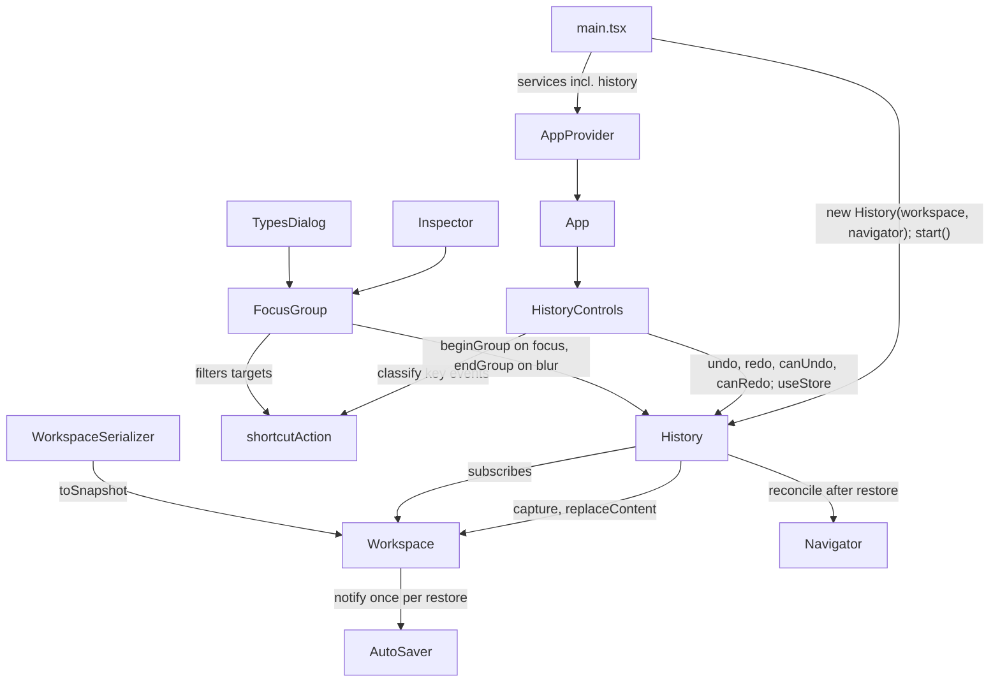

# Design Document

## Overview

Undo and Redo are built on one new domain class, `History`, which watches the `Workspace` and keeps two stacks of snapshots. `History` needs no call-site changes in the view. Every content edit already ends in `Workspace.signal.notify()`, so `History` subscribes, captures the content, and records a step when the content differs from the previous capture.

This one mechanism covers several requirements:

- A drag or resize calls `setPosition` or `setBounds` once at the end of the gesture, so it makes one step (2.1).
- A Rename commit calls `details.patch` once, so it makes one step (2.2).
- A cancelled Rename never touches the model, so it makes no step (2.4).
- A Rename committed unchanged, and any pan or zoom, produce identical captures (viewports are excluded), so they are dropped (2.4).

The Inspector and the Types dialog write to the model on every keystroke. For those, `History` has a focus-scoped group: `FocusGroup` opens a group when a Text_Input gains focus and closes it on blur. Changes inside the group do not become steps. Closing the group compares the content with the content at focus and records one step if it differs (2.3, 2.4).

Restoring replaces the Workspace content in place, keeps current viewports, and tells the `Navigator` to re-validate its path.

### Design decisions

| Decision | Chosen | Alternative | Why |
| --- | --- | --- | --- |
| Where steps are detected | `History` subscribes to the Workspace and compares captures | Explicit `history.begin()/commit()` calls in every view handler | No edits to `Level`, `ComponentNode`, `Inspector`, `TypesDialog`, `DeleteFlow` or `createAtPoint`. New edit paths are covered automatically. |
| Snapshot form | JSON string of the persisted shape with viewports neutralized | Deep-cloned object tree | Strings are immutable and compare with `===`. Equality is the "no change" test. |
| Undo model | Whole-content snapshots | Command objects with inverses | Matches the glossary and requirements. One code path, no per-command inverse to keep correct. |
| Grouping keystrokes | `History.beginGroup()/endGroup()` driven by one `FocusGroup` wrapper component around the Inspector and Types dialog fields | A group call on every input, or debouncing changes by time | One wrapper gives one home for the rule. Focus and blur match the user's idea of "one edit". A timer would split slow typing and merge unrelated edits. |
| Reconciling the Navigator | `History` calls `Navigator.reconcile()` right after the restore | Navigator subscribes to the Workspace | Existing tests construct `new Navigator({ root })`, which has no `subscribe`. The explicit call keeps them unchanged. |
| Snapshot serialization | Move `diagramToDto` logic into `Workspace.toSnapshot()`; `WorkspaceSerializer.serialize` delegates | Duplicate it inside `History` | One implementation of "Workspace to plain data" (reuse). |

## Architecture



Dependency direction is unchanged: `src/domain` has no React imports, and `src/persistence` does not import `History`. History is not reachable from `Workspace`, so it cannot be saved (6.1).

## Components and Interfaces

### History (new, `src/domain/History.ts`)

Responsibility: record content steps, hold the undo and redo stacks, and apply a step back to the Workspace.

```ts
export type Snapshot = string // opaque; produced and consumed only by Restorable

// What History needs from a Workspace. Narrow, so tests can use a fake.
export interface Restorable extends ObservableStore {
  capture(): Snapshot
  replaceContent(snapshot: Snapshot): void
}

export const HISTORY_LIMIT = 100

export class History implements ObservableStore {
  constructor(
    workspace: Restorable,
    levels: { reconcile(): void }, // the Navigator
    limit: number = HISTORY_LIMIT,
  )
  subscribe: (listener: () => void) => () => void
  getVersion: () => number
  get canUndo(): boolean
  get canRedo(): boolean
  start(): void // captures the baseline and subscribes to the workspace; no-op if started
  beginGroup(): void // no-op if a group is open
  endGroup(): void // no-op if no group is open
  undo(): void // closes an open group first; no-op on an empty stack
  redo(): void // closes an open group first; no-op on an empty stack
}
```

Behavior:

- `baseline` is the capture of the current content as of the last recorded step.
- On a workspace change, unless `applying` or `grouping` is set:
  - Capture `next`.
  - If `next === baseline`, return.
  - Otherwise push `baseline` onto the undo stack, clear the redo stack, set `baseline = next`, and notify (1.2, 2.x).
- Groups are a flag, not a counter, so a missed or doubled call cannot leave the count wrong:
  - `beginGroup` sets `grouping`. `baseline` is not touched, so it stays the content at focus.
  - While `grouping`, workspace changes are ignored.
  - `endGroup` clears `grouping` and then runs the same compare-and-push as an ordinary change (2.3, 2.4). Typing and then restoring the original text therefore records nothing.
- `undo` and `redo` call `endGroup()` first (2.5), then share one private `step(from, to)`:
  1. Pop `target` from `from`. Return if the stack is empty (5.4).
  2. Push the current `capture()` onto `to`.
  3. Set `applying`, call `workspace.replaceContent(target)`, clear `applying`.
  4. Set `baseline = target`.
  5. Call `levels.reconcile()`.
  6. Notify (1.3, 1.4).
- Pushing onto a stack drops the oldest entry once the stack length exceeds `limit` (3.1). The `limit` parameter exists so tests need not make 100+ edits.
- `canUndo` and `canRedo` back the disabled state of the buttons (1.5, 1.6). They lag behind typing inside an open group until the group closes. A button click moves focus first, which closes the group, so the buttons are current when they can be clicked.

Collaborators: `Restorable` (the Workspace), `Navigator`, and `ChangeSignal` (composed, like the other stores).
Used by: Requirements 1, 2, 3, 4, 5.4, 6.

### Workspace (extended)

New members:

```ts
toSnapshot(includeViewports = true): WorkspaceSnapshot
capture(): Snapshot // JSON.stringify(toSnapshot(false)); viewports written as DEFAULT_VIEWPORT
replaceContent(snapshot: Snapshot): void
```

- `root` becomes a getter over a private `_root`. `Navigator` and the view already read `workspace.root` each time, so none of them hold a stale root.
- `toSnapshot` is the existing `diagramToDto` logic moved from `WorkspaceSerializer`. `includeViewports = false` writes `DEFAULT_VIEWPORT` for every Diagram, which makes the result deterministic and viewport-free (Snapshot glossary).
- `replaceContent`:
  1. Parse the string. It is this class's own `capture()` output, not external input, so it needs no validation.
  2. Collect `id -> viewport` from the current tree.
  3. Rebuild `_root` and `_types` with `buildDiagram`, taking each Diagram's viewport from the collected map and falling back to the snapshot's viewport for Diagrams that no longer exist (4.2).
  4. Call `signal.notify()` once (4.1).
- Same-object replacement is not possible because Diagrams are built with immutable ids and lists. The view re-reads `navigator.current` on every Workspace change (`Layout` already subscribes to the Workspace and re-renders `CanvasView`), so `Level` receives the new `Diagram`. `Level` is keyed by Diagram id, so it does not remount and the React Flow viewport is untouched.

A Diagram that was deleted and then restored by undo gets the snapshot's neutral viewport, since its own viewport was lost with it. This is allowed by 4.2.

### WorkspaceSerializer (changed)

`serialize(workspace)` returns `{ ...workspace.toSnapshot(), schemaVersion: 4 }`, or simply `workspace.toSnapshot()`. `diagramToDto` is deleted from this file. `deserialize` is unchanged. Requirement: 6.1, plus code reuse.

### Navigator (extended)

```ts
reconcile(): void
```

Returns immediately if every id in `path` still resolves from the root. Otherwise sets `path = []` and notifies (4.3, 4.4). It does not call `trail()`, which throws on a stale path.

Ordering rule: `History` calls `reconcile()` synchronously after `replaceContent`, in the same task. React does not render inside a store listener, so no component sees the stale path.

### HistoryControls (new, `src/view/HistoryControls.tsx`)

Responsibility: render the Undo and Redo buttons in the Top_Bar and install the keyboard shortcuts.

- Reads `history` from `useApp()` and calls `useStore(history)`.
- Renders two `<button type="button">` elements, "Undo" and "Redo". Each has `disabled={!history.canUndo}` or `disabled={!history.canRedo}`, and calls `history.undo()` or `history.redo()` (1.1, 1.5, 1.6).
- A `useEffect` registers one `keydown` listener on `window`. For a handled shortcut it calls `preventDefault()` and then `undo()` or `redo()`.
- It ignores the event while a modal dialog is open (`document.querySelector('[aria-modal="true"]')`). `DeleteFlow` and `TypesDialog` hold or read Diagram objects. A restore would leave `DeleteFlow.pending.diagram` pointing at a detached tree (5.5).
- `App` renders it inside `.app-header`, next to the Types button. The header CSS already pushes `.header-action` right with `margin-left: auto`, so the buttons are grouped in one container that takes that margin.

Collaborators: `History`, `shortcutAction`, `useApp`, `useStore`. Used by: Requirements 1.1, 1.5, 1.6, 5.

### shortcutAction (new, `src/view/historyShortcut.ts`)

Pure function with no DOM or React dependency, so it is testable without a DOM. It mirrors `isEmptyCanvas` by checking structurally instead of using `instanceof`.

```ts
export type ShortcutEvent = {
  key: string
  metaKey: boolean
  ctrlKey: boolean
  shiftKey: boolean
  target: EventTarget | null
}
export function isTextInput(target: EventTarget | null): boolean // INPUT, TEXTAREA or isContentEditable
export function shortcutAction(e: ShortcutEvent, isMac: boolean): 'undo' | 'redo' | null
```

Rules:

- The primary modifier is `metaKey` on macOS and `ctrlKey` elsewhere. The other modifier must be absent.
- `key.toLowerCase() === 'z'`.
- `shiftKey` selects redo, otherwise undo.
- Any `isTextInput(target)` returns `null` (5.3).

`isMac` is computed once in `HistoryControls` from `navigator.userAgent`.
Used by: Requirement 5.1 to 5.3.

### FocusGroup (new, `src/view/FocusGroup.tsx`)

Responsibility: scope one History group to one Text_Input focus session, for any set of fields placed inside it.

```tsx
export function FocusGroup(props: { children: ReactNode; className?: string }): JSX.Element
```

- Reads `history` from `useApp()` and renders a `<div>` with `onFocus` and `onBlur`. React focus events bubble, so one wrapper covers every field inside it.
- `onFocus`: if `isTextInput(e.target)`, call `history.beginGroup()`.
- `onBlur`: if `isTextInput(e.target)`, call `history.endGroup()`. Moving focus between two fields closes one group and opens the next, so each field's edits are their own step.
- `useEffect` cleanup calls `history.endGroup()`. React does not fire blur when a focused field unmounts (for example the Inspector closing on a selection change), and this prevents a stuck group.
- `select` elements are not Text_Inputs. Each change is one discrete edit and already makes one step.

Wrapping points:

- `Inspector`: the field list, covering the name, description and port name inputs.
- `TypesDialog`: the list of Type name inputs.

The Rename textarea in `ComponentNode` is not wrapped. It edits a local draft and writes once on commit (2.2).

Collaborators: `History`, `isTextInput`, `useApp`. Used by: Requirements 2.3, 2.4, 2.5.

### Composition root and services (changed)

- `AppServices` gains `history: History`.
- `main.tsx` builds `new History(workspace, navigator)` after the load and the Navigator, calls `start()`, and passes it in `services`. A new Workspace gets a new History with empty stacks (6.2). The app currently loads once before History exists, so no clear operation is needed.
- `AutoSaver` is unchanged. A restore notifies the Workspace once, which marks it dirty and saves as for any edit (6.3). The saved shape is unchanged (6.1).

### Components reused, not changed

`ChangeSignal`, `ObservableStore`, `useStore`, `Level`, `ComponentNode`, `RenameInput`, `DeleteFlow` and `AutoSaver` need no code change. `Inspector` and `TypesDialog` change only by wrapping their fields in `FocusGroup`.

### Requirement to component map

| Requirement | Components |
| --- | --- |
| 1 Undo and redo | `History`, `HistoryControls` |
| 2 Step granularity | `History` (capture, compare, groups), `Workspace.capture`, `FocusGroup`, `isTextInput` |
| 3 Bounded history | `History` |
| 4 Restore behavior | `Workspace.replaceContent`, `Navigator.reconcile`, `History` |
| 5 Keyboard shortcuts | `shortcutAction`, `HistoryControls`, `History` |
| 6 Persistence | `main.tsx`, `WorkspaceSerializer`, `AutoSaver` (unchanged) |
| 7 Spec consistency | Verification only: neither `.kiro/specs/flow/requirements.md` nor `design.md` mentions undo/redo today |

## Data Models

```ts
type Snapshot = string // JSON of WorkspaceSnapshot with every viewport set to DEFAULT_VIEWPORT
```

History holds `undoStack: Snapshot[]`, `redoStack: Snapshot[]`, `baseline: Snapshot`, `applying: boolean` and `grouping: boolean`. Nothing is persisted. `WorkspaceSnapshot` and the schema version stay as they are.

Memory: at most 200 strings, each the size of the serialized Workspace.

## Error Handling

- Undo or redo on an empty stack returns without touching the Workspace or notifying (5.4).
- `replaceContent` parses only strings from `capture()`. A parse failure would be a bug, so it is not caught and surfaces (matches the `main.tsx` policy).
- If a restore removes the displayed Level, `reconcile()` moves to the root instead of leaving a stale path (4.4).
- A restore during an active Rename or an open group cannot come from a shortcut (a Text_Input has focus). A button click blurs the input first, and the blur commits the Rename or closes the group as its own step, so Undo then reverts that step. `undo()` and `redo()` also call `endGroup()` themselves as a guard (2.5).
- A group whose field unmounts without blur is closed by the `FocusGroup` cleanup. `endGroup()` is idempotent, so a repeated call is harmless.
- A Rename still pending in its 300 ms delay could start for a Component that no longer exists. `ComponentNode` then renders no input for it, so the effect is nil.

## Diagram Updates (`docs/diagrams/`)

Done in the tasks phase, in the same change as the code. `README.md` needs no new entry because no diagram file is added.

### system-architecture.mmd

- View subgraph: add nodes `HistoryControls`, `FocusGroup` and `shortcutAction["shortcutAction, isTextInput"]`.
- Domain subgraph: add `History --> Workspace` and `History --> Navigator`.
- Edges:
  - `Inspector --> FocusGroup` and `TypesDialog --> FocusGroup`
  - `FocusGroup -->|beginGroup on focus, endGroup on blur| History`
  - `FocusGroup -->|filters targets| shortcutAction`
  - `App -->|Undo and Redo buttons in header| HistoryControls`
  - `HistoryControls -->|undo, redo; useStore| History`
  - `HistoryControls -->|classifies key events| shortcutAction`
  - `History -->|subscribes; capture, replaceContent| Workspace`
  - `History -->|reconcile after restore| Navigator`
  - `WorkspaceSerializer -->|toSnapshot| Workspace`
- Change the `Main` services edge to `"services: workspace, navigator, history, notifier, scheduler"` and add `Main -->|creates and starts| History`.

### domain-model.mmd

- Add `class History` with `canUndo`, `canRedo`, `start()`, `beginGroup()`, `endGroup()`, `undo()` and `redo()`.
- Add `class Restorable` as `<<interface>>` with `capture()` and `replaceContent(snapshot)`.
- Add members:
  - `Workspace`: `toSnapshot(includeViewports)`, `capture()`, `replaceContent(snapshot)`.
  - `Navigator`: `reconcile()`.
- Add relationships:
  - `History ..|> ObservableStore`
  - `History --> ChangeSignal`
  - `History --> Restorable : captures and restores`
  - `Workspace ..|> Restorable`
  - `History --> Navigator : reconcile after restore`

### startup-and-save.mmd

- Add participant `H as History`.
- After `M->>M: new Navigator(workspace)`, add `M->>H: new History(workspace, navigator); start()` and `H->>W: subscribe`.
- Extend the change flow with `Note over H: undo or redo calls W.replaceContent, W notifies once, A saves as for any edit`.
- Add `Note over H: a focused Text_Input opens a group; changes inside it become one step on blur`.
- Update the README index description of `domain-model.mmd` to mention History.

## Correctness Properties

*A property is a characteristic or behavior that should hold true across all valid executions of a system-essentially, a formal statement about what the system should do. Properties serve as the bridge between human-readable specifications and machine-verifiable correctness guarantees.*

Reflection: 1.3 and 1.4 merge into one round trip. 1.2, 1.5, 1.6, 2.1 and 2.2 merge into one stack-discipline property. 2.3 and 2.4 (group case) merge into one grouping property, and 2.5 with the idempotence of `endGroup` into a second. 4.3 and 4.4 merge into one Navigator property. 5.1 to 5.3 are one classification property. Criteria 1.1, 6.1, 6.2, 6.3 and 7.1 are examples or smoke checks, not properties.

Generators reuse `commandsArb`, `applyCommand` and `buildWorkspace` from `src/domain/testing/workspaceArbitrary.ts`.

### Property 1: Undo and redo round trip

For any Workspace and any edit that changes content, undoing the edit restores the pre-edit content, and redoing afterwards restores the post-edit content (content compared by `capture()`).

**Validates: Requirements 1.3, 1.4**

### Property 2: Edits record one step

For any Workspace and any sequence of edits with undos interleaved, each edit that changes content increases the undo depth by exactly one and empties the redo stack. `canUndo` is true if and only if the undo stack is non-empty, and `canRedo` is true if and only if the redo stack is non-empty. This holds for a single `setPosition`, `setBounds` or `details.patch` that changes a value, made outside any group.

**Validates: Requirements 1.2, 1.5, 1.6, 2.1, 2.2**

### Property 3: Writes that leave content unchanged record nothing

For any Workspace, any `setViewport` call, and any `details.patch` that sets the values a Component already has, the undo stack, the redo stack and `capture()` are unchanged.

**Validates: Requirements 2.4**

### Property 4: History is bounded

For any limit L and any N content edits, the undo depth is `min(N, L)`. Undoing until empty yields the content as it was after edit `N - L`, or the initial content when `N <= L`. The same bound applies to the redo stack.

**Validates: Requirements 3.1**

### Property 5: Restore notifies once

For any history with a non-empty stack, a single `undo()` or `redo()` calls each Workspace subscriber exactly once.

**Validates: Requirements 4.1**

### Property 6: Restore keeps current viewports

For any Workspace, any edit, and any later viewport changes, after `undo()` every Diagram id that exists both before and after the restore has the same viewport it had before the restore.

**Validates: Requirements 4.2**

### Property 7: Navigator stays valid after restore

For any Workspace, any open path, and any `undo()` or `redo()`: if every id of the path still resolves in the restored content, the path is unchanged. Otherwise the path is empty and `navigator.current` is the root. `navigator.current` and `navigator.trail()` do not throw in either case.

**Validates: Requirements 4.3, 4.4**

### Property 8: Empty stacks are inert

For any Workspace with an empty undo stack (or redo stack), `undo()` (or `redo()`) leaves `capture()` and the Workspace version unchanged.

**Validates: Requirements 5.4**

### Property 9: Shortcut classification

For any key event, platform flag and target, `shortcutAction` returns `'undo'` if and only if the key is `z` (any case), the platform's primary modifier is held, the other modifier and shift are not held, and the target is not a Text_Input. It returns `'redo'` under the same conditions with shift held. In every other case it returns `null`.

**Validates: Requirements 5.1, 5.2, 5.3**

### Property 10: A group records one step

For any Workspace and any non-empty sequence of content edits made between `beginGroup()` and `endGroup()`, the undo depth grows by exactly one if the final content differs from the content at `beginGroup()`, and by zero otherwise. The redo stack is empty after a recorded step. A single `undo()` then restores the content as it was at `beginGroup()`. The result is independent of the number of edits in the sequence.

**Validates: Requirements 2.3, 2.4**

### Property 11: Closing a group is safe and implied by undo and redo

For any Workspace and any edits made inside an open group: calling `endGroup()` more than once records no more than the first call did. Calling `undo()` or `redo()` while the group is open first records the group as one step. A group-closing `undo()` then reverts exactly that step, and `redo()` restores the grouped content. A subsequent edit outside any group is recorded as its own step.

**Validates: Requirements 2.5**

## Testing Strategy

Dual approach: property tests for the eleven properties, and example tests for the rest.

Property tests:

- Files: `src/domain/history.property.test.ts` and `src/view/historyShortcut.property.test.ts`, matching `src/**/*.property.test.ts`.
- At least 100 runs per property (fast-check `numRuns: 100`).
- Each test carries the tag `Feature: undo-redo-buttons, Property N: <title>`.

Example tests (`src/**/*.test.ts`):

- `History.test.ts`:
  - Fresh History over a restored Workspace has empty stacks (6.2).
  - Edit then undo then a new edit clears redo.
  - Typing "abc" one character at a time inside a group gives one step; typing then restoring the original text gives none (2.3, 2.4).
  - Limit with a small injected value.
  - `canUndo` and `canRedo` after each operation.
- `Workspace.test.ts`:
  - `replaceContent` rebuilds types.
  - `capture` ignores viewport changes.
  - A deleted-then-restored Diagram gets the neutral viewport.
- `Navigator.test.ts`: `reconcile` on a valid path, a stale path, and the root.
- `WorkspaceSerializer.test.ts`: output is unchanged after the `toSnapshot` move, and equals the serialization of an equivalent fresh Workspace after edit and undo (6.1).
- `AutoSaver.test.ts` (or a History integration test): after `undo()` and `flush()`, the repository holds the restored content (6.3).
- Smoke check for 7.1: `grep -ri "undo\|redo" .kiro/specs/flow/requirements.md .kiro/specs/flow/design.md` shows no out-of-scope listing.

Not tested automatically: button rendering and disabled binding (1.1), and the `FocusGroup` focus and blur wiring (2.3). The group rule itself is covered by Properties 10 and 11 on `History`, and target filtering by `isTextInput`. DOM tests are out of scope for this project, and the binding is a one-line read of `canUndo` and `canRedo`.
